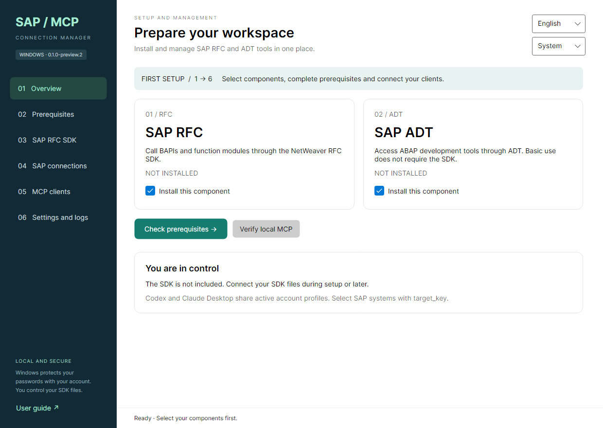

# SAP MCP Manager for Windows

[Türkçe](README.tr.md) · [User guide](docs/USER-GUIDE.md) · [Troubleshooting](docs/TROUBLESHOOTING.md)

Install SAP RFC and SAP ADT MCP servers, manage SAP connection profiles and Windows-protected passwords, and connect Codex or Claude Desktop from a desktop application. No source build, GitHub account, Git or compiler is required to use the installers.

**Preview: v0.1.0-preview.2.** Windows 10 22H2 and Windows 11 **x64**. English/Turkish and light/dark themes. macOS is planned. Installers are unsigned; clean Windows 10/11 and live SAP acceptance tests remain pending. Read the [release notes](docs/RELEASE-NOTES.md).

## Download

| Installer | Choose this when |
|---|---|
| [Online EXE](https://github.com/tamerinal/sap_mcp_windows/releases/download/v0.1.0-preview.2/SAP-MCP-Manager-0.1.0-preview.2-Windows-x64-Online.exe) | Internet is available to download missing runtimes. MCP packages and the self-contained manager are included. |
| [Offline EXE](https://github.com/tamerinal/sap_mcp_windows/releases/download/v0.1.0-preview.2/SAP-MCP-Manager-0.1.0-preview.2-Windows-x64-Offline.exe) | The target cannot download runtimes. Includes the same MCP packages plus runtime installers. |

[Preview assets and checksums](https://github.com/tamerinal/sap_mcp_windows/releases/tag/v0.1.0-preview.2). Compare `Get-FileHash -Algorithm SHA256` with `SHA256SUMS.txt`. SAP access still requires your corporate network. **SAP NetWeaver RFC SDK is not included in either EXE.**

## First setup

1. Run the EXE as your normal Windows user. Open **SAP MCP Manager** from Start. RFC and ADT start checked; keep one or both. Empty selection is rejected.
2. Under **Prerequisites**, select **Check again → Install Required Applications**. Install missing prerequisites individually or with **Install Selected**, then **Install / repair selected MCP components**.
3. For RFC, obtain the Windows x64 [SAP RFC SDK](https://support.sap.com/en/product/connectors/nwrfcsdk.html) with your authorized SAP account. Extract it and select the `nwrfcsdk` folder containing `lib/sapnwrfc.dll` and `lib/libsapucum.dll`. Attach it later if needed; basic ADT works without SDK.
4. Under **SAP connections**, choose **Application-managed connections** to create systems without SAP GUI, or choose a read-only SAP GUI landscape XML. Apply the source, select a system and save a user/client profile with a valid SAP password. DPAPI protects secrets for the current Windows user. Select one shared active profile per system.
5. Under **MCP clients**, select Codex and/or Claude Desktop, preview changes, resolve conflicts and apply. Existing files are backed up; other MCP records are preserved. Restart MCP servers in your client.
6. Run **Verify local MCP** for startup/tools without a SAP login. Use **Test RFC/ADT connection** when ready to contact SAP.

The manager can stay closed while clients run MCP. The header's **English / Türkçe** selector preserves open form entries and does not change the SAP profile language.

## What you provide

- SAP account, client and authorizations for the intended operations.
- Reachable SAP servers / ADT endpoints, VPN, DNS, firewall access and appropriate TLS certificates.
- Server host/system-number details, or an existing SAP GUI landscape with direct SAPGUI host/port connections. Message-server groups, SNC/SSO and include expansion are outside this preview.
- Your own licensed RFC SDK for RFC operations. The manager does not grant SAP access or change SAP-side passwords.

See [Connection sources: with or without SAP GUI](docs/CONNECTIONS.md) for add/edit/delete, source selection and file formats.

## Bugs and feature requests

Use the [bug report](https://github.com/tamerinal/sap_mcp_windows/issues/new?template=bug_report.yml) or [feature request](https://github.com/tamerinal/sap_mcp_windows/issues/new?template=feature_request.yml) form. The [reporting and tracking guide](docs/ISSUES.md) explains required information, statuses, priorities and filtered queues. Follow progress and release links in the issue, and Subscribe for GitHub notifications. Do not post credentials or real SAP files. Reports require a GitHub account; the app does not send reports automatically.

## Documentation and licensing

- [User guide](docs/USER-GUIDE.md): SDK later, profiles, password updates, clients, logs, repair and uninstall.
- [Troubleshooting](docs/TROUBLESHOOTING.md), [validation](docs/VALIDATION.md), [developer/build/release guide](docs/DEVELOPMENT.md).
- [Changelog](CHANGELOG.md), [contributing](CONTRIBUTING.md), [security](SECURITY.md).
- [MIT](LICENSE) covers author-owned published code. [Third-party notices](THIRD-PARTY-NOTICES.md) retain separate licenses.

RFC/ADT source repositories remain private. **Compiled MCP JavaScript and dependencies can be extracted from the public EXEs**; installers do not provide source confidentiality. Distribution-only path adaptations are recorded in each package's `build-info.json`. SDK files, credentials, real landscapes and logs are excluded from this repository and installers.
