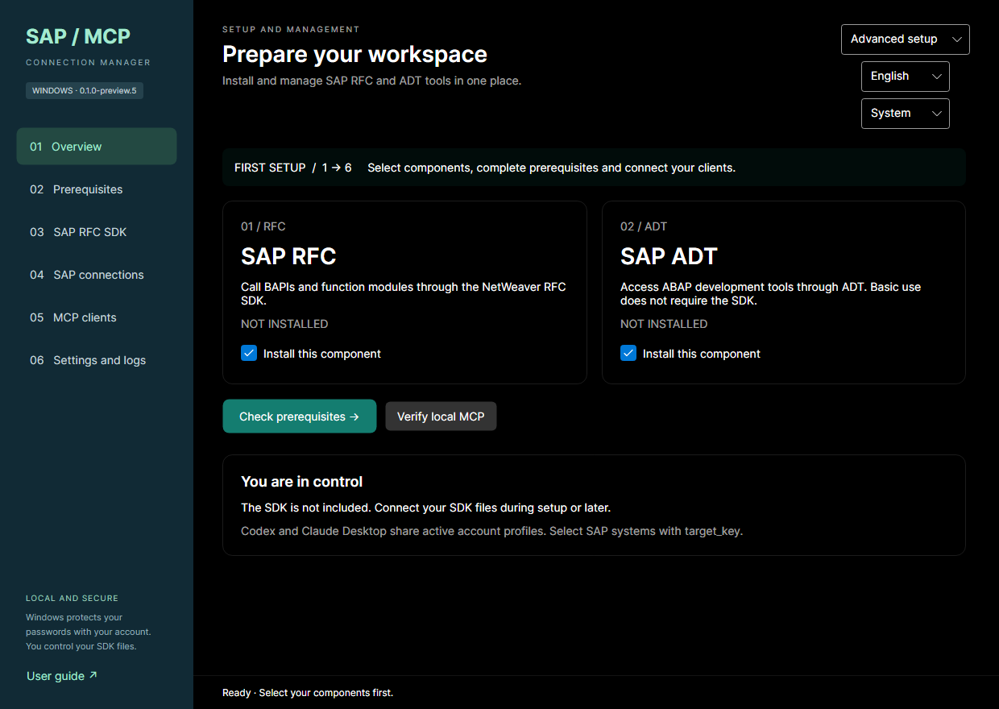

# SAP MCP Manager for Windows

## 0.1.0-preview.13 — Discovery startup and public documentation

Includes the Basic discovery settling wrapper from issue #7 and the merged public-content privacy cleanup. The wrapper warms up and settles inside the same Node process before importing the existing discovery entry point. ADT/RFC package archives and runtime pins are unchanged. Documentation uses fictional examples and omits environment-specific test notes. Production confirmation of the discovery fix, clean Windows acceptance and live SAP testing remain pending for this release.

## 0.1.0-preview.12 — Custom MCP integration help

Basic and Advanced client integration screens, and the final Basic summary, now provide local stdio MCP setup help for other agents and applications. Copy complete JSON, server entries for an existing `mcpServers` object, TOML tables or individual command/argument fields with actual installation paths. Basic examples follow current verification and RFC readiness; no eligible component produces no runnable example. Opening help and copying code do not start network checks or write client configurations. ADT/RFC packages are unchanged. See [custom integration help](docs/CUSTOM-INTEGRATION.md).

## 0.1.0-preview.11 — Fresh RFC readiness and ADT 0.4.3

Basic Verify recalculates RFC readiness from current settings after connection consent. Fixing the SDK or prerequisites in Advanced no longer requires restarting Manager. Python, PyRFC, Visual C++ runtimes, SDK, native import and RFC package blockers are reported separately. Explicit ADT-only mode remains `RFC_DISABLED_BY_MODE`.

A PyRFC file on disk does not prove native loading. A separate Python process imports `pyrfc.Connection` without preloading ICU or connecting to SAP. Native failure and timeout remain separate from missing dependencies and SAP ping outcomes. SDK settings affect child processes only, never persistent environment variables. Client registration requires both successful RFC verification and current readiness.

The package includes ADT 0.4.3: TLS warnings do not invalidate an otherwise successful connection; ping and repository tools share acceptance criteria. Origin-scoped certificate fingerprint pins are supported by the ADT package; no trust is granted automatically from the network. Reverify existing profiles. Online/Offline installers and SHA256 files are provided in the preview.11 prerelease.

## 0.1.0-preview.10 — 2026-11-02

Basic separates Save from Verify and never discovers while editing. SID is required. With explicit acceptance, HTTP/HTTPS works without uploaded certificates. RFC ping, server-list permission, RFC-assisted candidates, consented smart/full TCP scanning and final ADT authentication are separate stages. Denied RFC discovery preserves a successful ping. Failed RFC candidates offer a consented scan instead of claiming the service is inactive. Candidates continue after login rejection and stop at the first complete success.

Full TCP scanning targets 30 seconds and stops with partial results at 60 seconds; HTTP probing has a separate budget. ADT 0.4.2 discovery protocol 2 is required. Advanced, Host and shared production policy behavior are preserved. Online/Offline EXEs and SHA256 files are published in the GitHub prerelease. See the [Basic guide](docs/BASIC-SETUP.md).

[Türkçe](README.tr.md) · [User guide](docs/USER-GUIDE.md) · [Troubleshooting](docs/TROUBLESHOOTING.md)

Install SAP RFC and SAP ADT MCP servers, manage SAP connection profiles and Windows-protected passwords, and connect Codex or Claude Desktop from a desktop application. No source build, GitHub account, Git or compiler is required to use the installers.

**Last published preview: v0.1.0-preview.13.** Windows 10 22H2 and Windows 11 **x64**. English/Turkish and light/dark themes. macOS is planned. Installers are unsigned; clean Windows 10/11 and live SAP acceptance tests remain pending. Read the [release notes](docs/RELEASE-NOTES.md).

## Download

| Installer | Choose this when |
|---|---|
| [Online EXE](https://github.com/tamerinal/sap_mcp_windows/releases/download/v0.1.0-preview.13/SAP-MCP-Manager-0.1.0-preview.13-Windows-x64-Online.exe) | Internet is available to download missing runtimes. MCP packages and the self-contained manager are included. |
| [Offline EXE](https://github.com/tamerinal/sap_mcp_windows/releases/download/v0.1.0-preview.13/SAP-MCP-Manager-0.1.0-preview.13-Windows-x64-Offline.exe) | The target cannot download runtimes. Includes the same MCP packages plus runtime installers. |

[Preview assets and checksums](https://github.com/tamerinal/sap_mcp_windows/releases/tag/v0.1.0-preview.13). Compare `Get-FileHash -Algorithm SHA256` with `SHA256SUMS.txt`. SAP access still requires your corporate network. **SAP NetWeaver RFC SDK is not included in either EXE.**

## First setup

1. Install the Online/Offline EXE under your normal Windows account and open Manager. New installations start in **Basic**, existing configurations in **Advanced**; switch from the header.
2. In Basic select the SDK folder or **Continue with ADT only, without an SDK**. **Prepare installation** automatically checks/installs prerequisites and prepares MCP packages.
3. Enter host, instance, SID, client, user and password. **Save** stores local configuration only; **Verify** starts RFC and anonymous ADT discovery after warning/consent.
4. One working connection permits a warning and continuation with only its MCP; neither working preserves the previous profile. Preview/apply Codex/Claude configuration and restart client MCP processes.

The [Basic guide](docs/BASIC-SETUP.md) explains the flow. **Advanced** retains component selection, individual prerequisites, SDK, multiple connections/profiles, clients and logs; see the [full guide](docs/USER-GUIDE.md). Manager need not stay open. Switching language/mode preserves forms and does not change the SAP profile language.

## What you provide

- SAP account, client and authorizations for the intended operations.
- Reachable SAP servers / ADT endpoints, VPN, DNS, firewall access and appropriate TLS certificates.
- Server host/system-number details, or an existing SAP GUI landscape with direct SAPGUI host/port connections. Message-server groups, SNC/SSO and include expansion are outside this preview.
- Your own licensed RFC SDK for RFC operations. The manager does not grant SAP access or change SAP-side passwords.

See [Connection sources: with or without SAP GUI](docs/CONNECTIONS.md) for add/edit/delete, source selection and file formats.

## Bugs and feature requests

Use the [bug report](https://github.com/tamerinal/sap_mcp_windows/issues/new?template=bug_report.yml) or [feature request](https://github.com/tamerinal/sap_mcp_windows/issues/new?template=feature_request.yml) form. The [reporting and tracking guide](docs/ISSUES.md) explains required information, statuses, priorities and filtered queues. Follow progress and release links in the issue, and Subscribe for GitHub notifications. Do not post credentials or real SAP files. Reports require a GitHub account; the app does not send reports automatically.

## Documentation and licensing

- [User guide](docs/USER-GUIDE.md): SDK later, profiles, password updates, clients, logs, repair and uninstall.
- [Troubleshooting](docs/TROUBLESHOOTING.md), [validation](docs/VALIDATION.md), [developer/build/release guide](docs/DEVELOPMENT.md).
- [Changelog](CHANGELOG.md), [contributing](CONTRIBUTING.md), [security](SECURITY.md).
- [MIT](LICENSE) covers author-owned published code. [Third-party notices](THIRD-PARTY-NOTICES.md) retain separate licenses.

RFC/ADT source repositories remain private. **Compiled MCP JavaScript and dependencies can be extracted from the public EXEs**; installers do not provide source confidentiality. Distribution-only path adaptations are recorded in each package's `build-info.json`. SDK files, credentials, real landscapes and logs are excluded from this repository and installers.

Preview.3 fixes SDK/ICU startup when SDK lib is absent from PATH. After upgrading, verify the saved SDK folder and restart client MCP servers. [SDK startup troubleshooting](docs/TROUBLESHOOTING.md#rfc-sdk--icu-startup-and-emptystdout) · [Issue #3](https://github.com/tamerinal/sap_mcp_windows/issues/3). Live SAP acceptance is pending.

Preview.4 adds explicit ADT endpoints, profile certificate trust, staged diagnosis and address help. **Upgrade the Manager, install/repair the ADT component, then restart client MCP servers.** Legacy blank URLs need a confirmed address before authentication. [ADT/TLS guide](docs/ADT-CONNECTIONS.md) · [Issue #4](https://github.com/tamerinal/sap_mcp_windows/issues/4).

[Basic setup and automatic ADT discovery](docs/BASIC-SETUP.md).
