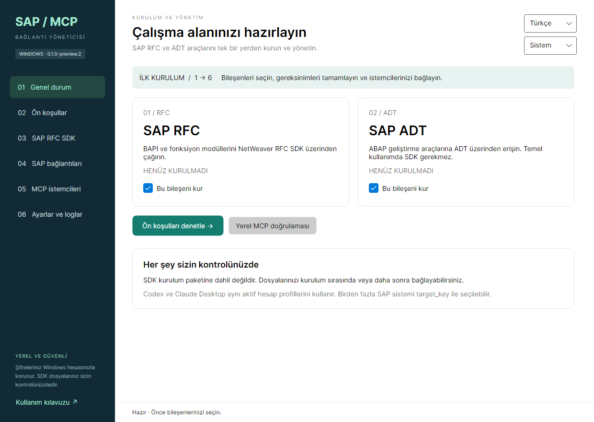

# Windows için SAP MCP Yöneticisi

[English](README.md) · [Kullanım kılavuzu](docs/USER-GUIDE.tr.md) · [Sorun giderme](docs/TROUBLESHOOTING.tr.md)

SAP RFC ve SAP ADT MCP sunucularını kurun, SAP bağlantı profillerini ve Windows ile korunan şifreleri yönetin, Codex veya Claude Desktop bağlantısını masaüstünden hazırlayın. Kurulumları kullanmak için kaynak derleme, GitHub hesabı, Git veya derleyici gerekmez.

**Önizleme: v0.1.0-preview.2.** Windows 10 22H2 ve Windows 11 **x64**. İngilizce/Türkçe ve açık/koyu tema. macOS planlanmaktadır. Kurulumlar imzasızdır; temiz Windows 10/11 ve canlı SAP kabul testleri henüz tamamlanmamıştır. [Sürüm notlarını](docs/RELEASE-NOTES.tr.md) okuyun.

## İndirme

| Kurulum | Ne zaman seçilmeli? |
|---|---|
| [İnternetli EXE](https://github.com/tamerinal/sap_mcp_windows/releases/download/v0.1.0-preview.2/SAP-MCP-Manager-0.1.0-preview.2-Windows-x64-Online.exe) | Eksik çalışma zamanlarını indirmek için internet varsa. MCP paketleri ve kendi çalışma zamanını içeren yönetici dahildir. |
| [Çevrimdışı EXE](https://github.com/tamerinal/sap_mcp_windows/releases/download/v0.1.0-preview.2/SAP-MCP-Manager-0.1.0-preview.2-Windows-x64-Offline.exe) | Hedef bilgisayar çalışma zamanlarını indiremiyorsa. Aynı MCP paketlerine çalışma zamanı kurulumları eklenir. |

[Önizleme dosyaları ve hashler](https://github.com/tamerinal/sap_mcp_windows/releases/tag/v0.1.0-preview.2). `Get-FileHash -Algorithm SHA256` sonucunu `SHA256SUMS.txt` ile karşılaştırın. SAP erişimi için kurum ağı gerekir. **SAP NetWeaver RFC SDK iki EXE’ye de dahil değildir.**

## İlk kurulum

1. EXE’yi normal Windows kullanıcınızla çalıştırın. Başlat’tan **SAP MCP Manager** açın. RFC ve ADT başlangıçta işaretlidir; birini veya ikisini bırakın. Boş seçim engellenir.
2. **Ön koşullar → Tekrar denetle → Gerekli Uygulamaları Kur** seçin. Eksikleri tek tek veya **Seçilenleri Kur** ile kurup **Seçili MCP bileşenlerini kur / onar** düğmesini kullanın.
3. RFC için yetkili SAP hesabınızla Windows x64 [SAP RFC SDK](https://support.sap.com/en/product/connectors/nwrfcsdk.html) edinin. Açıp `lib/sapnwrfc.dll` ve `lib/libsapucum.dll` içeren `nwrfcsdk` klasörünü seçin. Sonradan bağlayabilirsiniz; temel ADT SDK gerektirmez.
4. **SAP bağlantıları** ekranında SAP GUI olmadan sistem oluşturmak için **Uygulamanın bağlantıları**, mevcut XML için **SAP GUI bağlantıları (salt okunur)** seçin. Kaynağı uygulayıp sistem seçin; geçerli SAP şifresiyle kullanıcı/client profili kaydedin. DPAPI şifreyi mevcut Windows kullanıcısıyla korur. Sistem başına ortak aktif profil seçin.
5. **MCP istemcileri** ekranında Codex ve/veya Claude Desktop seçin, önizleyin, çakışmaları çözün ve uygulayın. Mevcut dosyalar yedeklenir; diğer MCP kayıtları korunur. İstemcide MCP’leri yeniden başlatın.
6. SAP’ye giriş yapmadan başlangıç/araç kontrolü için **Yerel MCP doğrulaması** kullanın. SAP’ye bağlanmaya hazır olduğunuzda **RFC/ADT bağlantısını test et** seçin.

İstemciler MCP’yi çalıştırırken yönetici kapalı kalabilir. Üstteki **English / Türkçe** seçimi açık form alanlarını korur; SAP profil dilini değiştirmez.

## Sizin sağlayacaklarınız

- Yapılacak işlemlere yetkili SAP hesabı, client ve SAP yetkileri.
- Erişilebilir SAP sunucuları / ADT adresleri, VPN, DNS, güvenlik duvarı erişimi ve uygun TLS sertifikaları.
- Sunucu/sistem numarası bilgileri veya doğrudan SAPGUI host/port bağlantılı mevcut landscape dosyası. Message-server grupları, SNC/SSO ve include genişletmesi bu önizlemenin dışındadır.
- RFC için kendi lisanslı SDK’nız. Yönetici SAP erişimi vermez veya SAP’deki parolayı değiştirmez.

Ekleme/düzenleme/silme, kaynak seçimi ve dosya biçimleri için [SAP GUI ile veya olmadan bağlantı kılavuzuna](docs/CONNECTIONS.tr.md) bakın.

## Hata ve geliştirme talepleri

[Hata bildirimi](https://github.com/tamerinal/sap_mcp_windows/issues/new?template=bug_report.yml) veya [geliştirme isteği](https://github.com/tamerinal/sap_mcp_windows/issues/new?template=feature_request.yml) formunu kullanın. [Bildirim ve takip kılavuzu](docs/ISSUES.tr.md) gereken bilgileri, durumları, öncelikleri ve filtreli kuyrukları açıklar. İlerleme ve sürüm bağlantılarını kayıttan izleyin; GitHub bildirimi için Subscribe kullanın. Şifre veya gerçek SAP dosyası paylaşmayın. Bildirim için GitHub hesabı gerekir; uygulama otomatik bildirim göndermez.

## Belgeler ve lisans

- [Kullanım kılavuzu](docs/USER-GUIDE.tr.md): sonradan SDK, profiller, şifre güncelleme, istemciler, log, onarım ve kaldırma.
- [Sorun giderme](docs/TROUBLESHOOTING.tr.md), [doğrulama](docs/VALIDATION.tr.md), [geliştirici/derleme/yayın kılavuzu](docs/DEVELOPMENT.tr.md).
- [Sürüm geçmişi](CHANGELOG.tr.md), [katkı](CONTRIBUTING.tr.md), [güvenlik](SECURITY.tr.md).
- [MIT](LICENSE) yazara ait yayımlanan kodu kapsar. [Üçüncü taraf bildirimleri](THIRD-PARTY-NOTICES.tr.md) ayrı lisansları korur.

RFC/ADT kaynak depoları özel kalır. **Derlenmiş MCP JavaScript kodu ve bağımlılıkları public EXE’lerden çıkarılabilir**; kurulum kaynak gizliliği sağlamaz. Yalnız dağıtıma uygulanan yol uyarlamaları her paketin `build-info.json` dosyasına kaydedilir. SDK, şifreler, gerçek landscape ve loglar depoya ve kurulumlara dahil edilmez.
