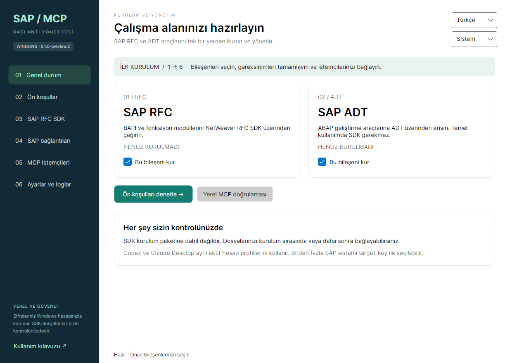

# Windows için SAP MCP Yöneticisi

## 0.1.0-preview.14 — OpenCode entegrasyonu ve Advanced doğrulama

Basic ve Advanced, global/proje dosyası seçimi, önizleme, yedekleme ve JSONC yorum/talimat korumasıyla OpenCode V1 veya V2’ye SAP MCP kaydı ekleyebilir. Advanced Bağlantılar ekranındaki **Otomatik keşfet ve doğrula**, Basic’in keşif/onay akışını ve ayrı ADT/RFC sonuçlarını kullanır. Sonuç forma gelir; URL/TLS alanlarını inceleyip Kaydet’e basana kadar kayıt yapılmaz. Basic davranışı ve MCP/runtime arşivleri korunur.

## 0.1.0-preview.13 — Keşif başlangıcı ve public dokümanlar

Issue #7 için Basic keşif başlangıç sarmalayıcısını ve birleştirilmiş public içerik gizlilik temizliğini içerir. Sarmalayıcı, mevcut keşif işlevini çağırmadan önce aynı Node sürecinde ön bağlantıları ve beklemeyi çalıştırır. ADT/RFC paket arşivleri ve sabit runtime sürümleri korunur. Belgelerde kurgusal örnekler kullanılır; ortama özel test notları yayımlanmaz. Keşif düzeltmesinin üretim ortamı teyidi, temiz Windows kabulü ve canlı SAP testleri bu sürüm için henüz yapılmadı.

## 0.1.0-preview.12 — Özel MCP entegrasyon yardımı

Basic ve Advanced istemci entegrasyonu ekranları ile son Basic özetinde diğer agent ve uygulamalara yerel stdio MCP ekleme yardımı bulunur. Gerçek kurulum yollarıyla tam JSON, mevcut `mcpServers` nesnesine eklenecek sunucu girdileri, TOML tabloları veya ayrı komut/argüman alanları kopyalanabilir. Basic örnekleri güncel doğrulama ve RFC hazırlığını izler; uygun bileşen yoksa çalıştırılabilir kod üretilmez. Yardımı açmak ve kopyalamak ağ kontrolü başlatmaz veya istemci yapılandırmasını değiştirmez. ADT/RFC paketleri değişmemiştir. [Özel entegrasyon yardımına](docs/CUSTOM-INTEGRATION.tr.md) bakın.

## 0.1.0-preview.11 — RFC hazırlık durumu ve ADT 0.4.3

Basic Doğrula, uyarı kabul edildikten sonra RFC hazırlığını güncel ayarlardan yeniden hesaplar. SDK veya bağımlılıklar Advanced'te düzeltildiğinde uygulamayı yeniden başlatmak gerekmez. Python, PyRFC, Visual C++ runtime'ları, SDK, native import ve RFC paket dosyalarının engel durumları ayrı gösterilir. Açık yalnız-ADT tercihi `RFC_DISABLED_BY_MODE` olarak korunur.

PyRFC dosyasının diskte bulunması native yükleme başarısı sayılmaz. Ayrı Python süreci, ICU'yu önceden yüklemeden ve SAP bağlantısı yapmadan `pyrfc.Connection` import eder. Native hata ve timeout, eksik bağımlılıktan ve SAP ping sonucundan ayrılır. SDK yolu yalnız alt süreçlere aktarılır; kalıcı ortam değişkenleri değiştirilmez. İstemci kaydı başarılı RFC doğrulaması ve güncel hazırlık sonucunu birlikte gerektirir.

Paket ADT 0.4.3 içerir: TLS uyarıları başarılı bağlantıyı bozmaz; ping ve repository araçları aynı kabul kuralını kullanır. Origin'e bağlı sertifika parmak izi desteği ADT paketindedir; sertifikaya ağdan otomatik güven verilmez. Eski doğrulamaları yeniden çalıştırın. Online/Offline kurulumlar ve SHA256 dosyaları preview.11 ön sürümünde sunulur.

## 0.1.0-preview.10 — 2026-11-02

Basic artık Kaydet ve Doğrula işlemlerini ayırır; alan düzenlenirken keşif çalışmaz. SID zorunludur. Açık kabul sonrasında HTTP/HTTPS sertifika yüklemeden kullanılabilir. RFC ping ve sunucu listesi kontrolü, RFC destekli adaylar, onaylı akıllı/tam TCP taraması ve son ADT kimlik doğrulaması ayrı aşamalardır. Yetkisiz RFC keşfi başarılı ping sonucunu bozmaz. RFC adayları sonuç vermezse onayla taramaya geçilir; servis kapalı varsayılmaz. Her aday giriş reddinden sonra da denenir; ilk tam başarıda durulur.

Tam TCP taraması 30 saniyeyi hedefler, 60 saniyede kısmi sonuçla durur; HTTP prob süresi ayrıdır. ADT 0.4.2 keşif protokolü 2 gereklidir. Advanced, Host ve ortak production policy davranışı korunur. Online/Offline EXE ve SHA256 dosyaları GitHub ön sürümünde yayımlanır. Ayrıntılar [Basic kılavuzunda](docs/BASIC-SETUP.tr.md).

[English](README.md) · [Kullanım kılavuzu](docs/USER-GUIDE.tr.md) · [Sorun giderme](docs/TROUBLESHOOTING.tr.md)

SAP RFC ve SAP ADT MCP sunucularını kurun, SAP bağlantı profillerini ve Windows ile korunan şifreleri yönetin, Codex veya Claude Desktop bağlantısını masaüstünden hazırlayın. Kurulumları kullanmak için kaynak derleme, GitHub hesabı, Git veya derleyici gerekmez.

**Son yayımlanmış önizleme: v0.1.0-preview.14.** Windows 10 22H2 ve Windows 11 **x64**. İngilizce/Türkçe ve açık/koyu tema. macOS planlanmaktadır. Kurulumlar imzasızdır; temiz Windows 10/11 ve canlı SAP kabul testleri henüz tamamlanmamıştır. [Sürüm notlarını](docs/RELEASE-NOTES.tr.md) okuyun.

## İndirme

| Kurulum | Ne zaman seçilmeli? |
|---|---|
| [İnternetli EXE](https://github.com/tamerinal/sap_mcp_windows/releases/download/v0.1.0-preview.14/SAP-MCP-Manager-0.1.0-preview.14-Windows-x64-Online.exe) | Eksik çalışma zamanlarını indirmek için internet varsa. MCP paketleri ve kendi çalışma zamanını içeren yönetici dahildir. |
| [Çevrimdışı EXE](https://github.com/tamerinal/sap_mcp_windows/releases/download/v0.1.0-preview.14/SAP-MCP-Manager-0.1.0-preview.14-Windows-x64-Offline.exe) | Hedef bilgisayar çalışma zamanlarını indiremiyorsa. Aynı MCP paketlerine çalışma zamanı kurulumları eklenir. |

[Önizleme dosyaları ve hashler](https://github.com/tamerinal/sap_mcp_windows/releases/tag/v0.1.0-preview.14). `Get-FileHash -Algorithm SHA256` sonucunu `SHA256SUMS.txt` ile karşılaştırın. SAP erişimi için kurum ağı gerekir. **SAP NetWeaver RFC SDK iki EXE’ye de dahil değildir.**

## İlk kurulum

1. Online/Offline EXE’yi normal Windows hesabınızla kurup Manager’ı açın. Yeni kurulum **Basic**, mevcut yapılandırma **Advanced** ile açılır; üst bölümden değiştirebilirsiniz.
2. Basic’te SDK klasörünü seçin veya **SDK olmadan yalnız ADT** işaretleyin. **Kurulumu hazırla** eksik bağımlılıkları ve MCP paketlerini otomatik hazırlar.
3. Host, instance, SID, client, kullanıcı ve şifre girin. **Kaydet** yalnız yerel kayıt yapar; **Doğrula** uyarı/onay sonrasında RFC ve anonim ADT keşfini başlatır.
4. Biri çalışıyorsa uyarıyla yalnız çalışan MCP ile devam edilir; ikisi başarısızsa önceki profil korunur. Codex/Claude ayarlarını önizleyip uygulayın, MCP süreçlerini yeniden başlatın.

[Basic kılavuzu](docs/BASIC-SETUP.tr.md) tüm akışı açıklar. **Advanced** mevcut bileşen seçimi, ön koşulları tek tek kurma, SDK, çoklu bağlantı/profil, istemci ve log ekranlarını korur; ayrıntılar [kullanım kılavuzundadır](docs/USER-GUIDE.tr.md). Manager istemciler çalışırken kapalı kalabilir. Dil/mod değiştirmek açık form alanlarını korur ve SAP profil dilini değiştirmez.

## Sizin sağlayacaklarınız

- Yapılacak işlemlere yetkili SAP hesabı, client ve SAP yetkileri.
- Erişilebilir SAP sunucuları / ADT adresleri, VPN, DNS, güvenlik duvarı erişimi ve uygun TLS sertifikaları.
- Sunucu/sistem numarası bilgileri veya doğrudan SAPGUI host/port bağlantılı mevcut landscape dosyası. Message-server grupları, SNC/SSO ve include genişletmesi bu önizlemenin dışındadır.
- RFC için kendi lisanslı SDK’nız. Yönetici SAP erişimi vermez veya SAP’deki parolayı değiştirmez.

Ekleme/düzenleme/silme, kaynak seçimi ve dosya biçimleri için [SAP GUI ile veya olmadan bağlantı kılavuzuna](docs/CONNECTIONS.tr.md) bakın.

## Hata ve geliştirme talepleri

[Hata bildirimi](https://github.com/tamerinal/sap_mcp_windows/issues/new?template=bug_report.yml) veya [geliştirme isteği](https://github.com/tamerinal/sap_mcp_windows/issues/new?template=feature_request.yml) formunu kullanın. [Bildirim ve takip kılavuzu](docs/ISSUES.tr.md) gereken bilgileri, durumları, öncelikleri ve filtreli kuyrukları açıklar. İlerleme ve sürüm bağlantılarını kayıttan izleyin; GitHub bildirimi için Subscribe kullanın. Şifre veya gerçek SAP dosyası paylaşmayın. Bildirim için GitHub hesabı gerekir; uygulama otomatik bildirim göndermez.

## Belgeler ve lisans

- [Kullanım kılavuzu](docs/USER-GUIDE.tr.md): sonradan SDK, profiller, şifre güncelleme, istemciler, log, onarım ve kaldırma.
- [Sorun giderme](docs/TROUBLESHOOTING.tr.md), [doğrulama](docs/VALIDATION.tr.md), [geliştirici/derleme/yayın kılavuzu](docs/DEVELOPMENT.tr.md).
- [Sürüm geçmişi](CHANGELOG.tr.md), [katkı](CONTRIBUTING.tr.md), [güvenlik](SECURITY.tr.md).
- [MIT](LICENSE) yazara ait yayımlanan kodu kapsar. [Üçüncü taraf bildirimleri](THIRD-PARTY-NOTICES.tr.md) ayrı lisansları korur.

RFC/ADT kaynak depoları özel kalır. **Derlenmiş MCP JavaScript kodu ve bağımlılıkları public EXE’lerden çıkarılabilir**; kurulum kaynak gizliliği sağlamaz. Yalnız dağıtıma uygulanan yol uyarlamaları her paketin `build-info.json` dosyasına kaydedilir. SDK, şifreler, gerçek landscape ve loglar depoya ve kurulumlara dahil edilmez.

Preview.3, SDK lib PATH içinde yokken oluşan SDK/ICU başlangıç hatasını düzeltir. Güncelleme sonrası kayıtlı SDK klasörünü doğrulayın ve istemcilerde MCP süreçlerini yeniden başlatın. [SDK başlangıç sorunlarını giderme](docs/TROUBLESHOOTING.tr.md) · [Kayıt #3](https://github.com/tamerinal/sap_mcp_windows/issues/3). Canlı SAP kabulü beklemektedir.

Preview.4; açık ADT adresi, profile özel sertifika güveni, aşamalı tanılama ve adres bulma yardımı ekler. **Manager’ı güncelleyin, ADT bileşenini kurun/onarın ve istemcide MCP’leri yeniden başlatın.** Eski boş URL’ler kimlik doğrulamadan önce doğrulanmış adres gerektirir. [ADT/TLS kılavuzu](docs/ADT-CONNECTIONS.tr.md) · [Kayıt #4](https://github.com/tamerinal/sap_mcp_windows/issues/4).

[Basic kurulum ve otomatik ADT keşfi](docs/BASIC-SETUP.tr.md).

[OpenCode ve Advanced otomatik doğrulama](docs/OPENCODE-ADVANCED.tr.md).
