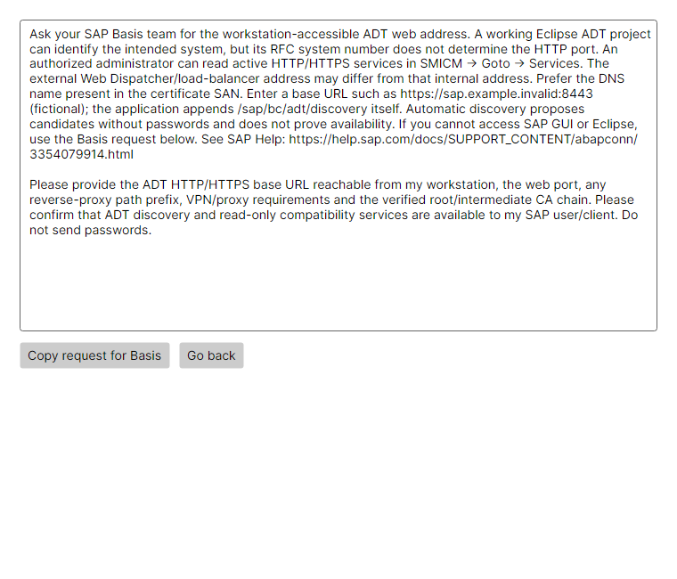

# ADT endpoints, TLS and diagnosis

[Home](../README.md) · [User guide](USER-GUIDE.md)

## Find and save the ADT URL

Ask your SAP Basis team for the workstation-accessible ADT web address. A working Eclipse ADT project can identify the intended system, but its RFC system number does not determine the HTTP port. An authorized administrator can read active HTTP/HTTPS services in SMICM → Goto → Services. The external Web Dispatcher/load-balancer address may differ from that internal address. Prefer the DNS name present in the certificate SAN. Enter a base URL such as https://sap.example.invalid:8443 (fictional); the application appends /sap/bc/adt/discovery itself. Automatic discovery proposes candidates without passwords and does not prove availability. If you cannot access SAP GUI or Eclipse, use the Basis request below. See SAP Help: https://help.sap.com/docs/SUPPORT_CONTENT/abapconn/3354079914.html

### Request to send to Basis

Please provide the ADT HTTP/HTTPS base URL reachable from my workstation, the web port, any reverse-proxy path prefix, VPN/proxy requirements and the verified root/intermediate CA chain. Please confirm that ADT discovery and read-only compatibility services are available to my SAP user/client. Do not send passwords.

The base URL is independent of the RFC system number and SAP client. Keep client/language/account in their own fields. Explicit adtBaseUrl wins. A trailing /sap/bc/adt is removed once; discovery is appended by the client. Queries, fragments, embedded credentials and deeper service URLs are rejected. Reverse-proxy prefixes, IPv4/IPv6 and custom ports are supported. HTTP sends credentials without TLS protection and is always marked with a warning.

Old profiles and DPAPI files are preserved. A legacy blank URL no longer triggers credential-bearing port guesses: select and save a confirmed URL first. Imported legacy URL lists remain in profile data; the first configured address is used only if the explicit field is blank. Address suggestions are opt-in, target-host-only and unauthenticated. Candidate responses including 401/404 do not prove ADT availability. Selecting a suggestion fills the form; save it before testing.

## Profile certificate trust

Save the profile first, then open **Profile certificates**. Obtain root/intermediate CA certificates or the verified self-signed public certificate from Basis over a trusted channel. Import PEM/DER (.pem/.cer/.crt), inspect Subject, Issuer, UTC validity, SAN and SHA-256, confirm the fingerprint with your administrator, then save the trust references. Public certificate files are copied to the application's profile-specific data folder. PFX/private keys are rejected. Removing a reference removes trust from future calls; orphan public files may remain on disk and are not automatically trusted.

Trust combines Node defaults, existing startup extra CAs, Windows trust and only this profile's files. Adding a CA here does not add it to Windows or another profile. Intermediate certificates complete a chain but do not become standalone roots. Hostname/IP SAN and validity still must match. A trusted self-signed certificate for another hostname still fails. Missing files, changed certificate fingerprints and malformed files block the connection.

**Inspect server certificate (no login)** returns unverified metadata without sending account credentials or granting trust. It intentionally permits an untrusted handshake only for inspection. Use a verified certificate file to add trust; do not trust a certificate merely because the network supplied it. An inspection failure may leave no certificate metadata if the network/TLS protocol itself is unavailable.

The advanced TLS-bypass checkbox is per-profile, off for new profiles and visibly warned. It is not a verified secure connection. There is no global TLS-disable operation. Use a correctly trusted certificate rather than leaving bypass enabled.

## Test the selected saved profile

**Test ADT connection** uses the saved selected profile through SapMcpHost and the actual MCP transport, including a non-active profile. A temporary private mapping contains only secret references; the shared active account for Codex/Claude does not change. Unsaved fields must be saved first. Old ADT packages are blocked with an install/repair message until their Preview.4 connection capability is present.

Stages: configuration → DNS/TCP → TLS for HTTPS → authentication → ADT discovery → read-only compatibility graph. Valid XML namespaces/structures are required. An open port, 401, arbitrary XML/HTML or root-path 404 is insufficient. No root-path 404 alone is interpreted as ADT absence. Anonymous resources do not prove the supplied account; the result remains unverified. First credential failure stops the test and automatic retries; do not repeatedly retry an unchanged wrong password.

Errors distinguish DNS, refused TCP, timeout, name/date/trust/chain TLS issues, 401 authentication, 403 authorization and service/content problems. Missing issuer versus missing trust root cannot always be determined from available evidence: TLS_CHAIN_UNRESOLVED reports that ambiguity. Ask Basis to check the complete chain and routing instead of disabling TLS globally.

Existing HTTP_PROXY/HTTPS_PROXY/ALL_PROXY/NO_PROXY variables are honored; HTTP proxy forwarding and HTTPS CONNECT use the shared transport. Proxy URLs/secrets and OS environment are not rewritten by Manager. With a proxy, network stages refer to the effective route; end-to-end origin TLS is still verified. Interactive proxy authentication, SSO/mTLS and new proxy management UI are not supplied.

Profile and certificate changes are read on the next call; no target-only URL cache can override them. Restart client MCP servers after installing the new ADT package, changing Node/environment or updating Windows trust. Settings, profiles, DPAPI secrets and client registrations are preserved across Manager upgrades.

## Support, tests and limits

Export the masked support report from the diagnosis dialog. It contains only approved stage/status/code metadata and masked configuration; no endpoint, account, certificate identity, token, password, cookie, headers or raw body. Do not attach real mapping, CA files, native traces or PATH to public issues.

Local synthetic HTTP/TLS tests cover profile isolation, chains, self-signed, SAN/date errors, redirects, proxies, authentication and false-positive content. Manager/Host/MCP consistency is checked against a local fixture without live SAP. Native keyboard/accessibility, clean Windows/GUI-free installation and authorized customer/live SAP acceptance remain pending until actually performed. Automatic OCSP/CRL/AIA retrieval, SSO/mTLS and SAP-side service/certificate changes are outside this delivery. Windows/Node trust rules are not identical to browser/Eclipse trust stores; a browser success alone is not proof of MCP trust.

