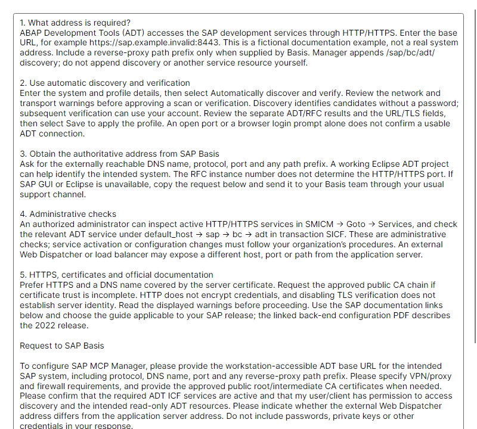

# ADT endpoints, TLS and diagnosis

[Home](../README.md) · [User guide](USER-GUIDE.md)

## Find and save the ADT URL

### 1. What address is required?

ABAP Development Tools (ADT) accesses the SAP development services through HTTP/HTTPS. Enter the base URL, for example https://sap.example.invalid:8443. This is a fictional documentation example, not a real system address. Include a reverse-proxy path prefix only when supplied by Basis. Manager appends /sap/bc/adt/discovery; do not append discovery or another service resource yourself.

### 2. Use automatic discovery and verification

Enter the system and profile details, then select Automatically discover and verify. Review the network and transport warnings before approving a scan or verification. Discovery identifies candidates without a password; subsequent verification can use your account. Review the separate ADT/RFC results and the URL/TLS fields, then select Save to apply the profile. An open port or a browser login prompt alone does not confirm a usable ADT connection.

### 3. Obtain the authoritative address from SAP Basis

Ask for the externally reachable DNS name, protocol, port and any path prefix. A working Eclipse ADT project can help identify the intended system. The RFC instance number does not determine the HTTP/HTTPS port. If SAP GUI or Eclipse is unavailable, copy the request below and send it to your Basis team through your usual support channel.

### 4. Administrative checks

An authorized administrator can inspect active HTTP/HTTPS services in SMICM → Goto → Services, and check the relevant ADT service under default_host → sap → bc → adt in transaction SICF. These are administrative checks; service activation or configuration changes must follow your organization’s procedures. An external Web Dispatcher or load balancer may expose a different host, port or path from the application server.

### 5. HTTPS, certificates and official documentation

Prefer HTTPS and a DNS name covered by the server certificate. Request the approved public CA chain if certificate trust is incomplete. HTTP does not encrypt credentials, and disabling TLS verification does not establish server identity. Read the displayed warnings before proceeding. Use the SAP documentation links below and choose the guide applicable to your SAP release; the linked back-end configuration PDF describes the 2022 release.

[SAP ADT documentation](https://help.sap.com/docs/ABAP_DEVELOPMENT_TOOLS_FOR_ECLIPSE) · [SAP back-end configuration guide (2022)](https://help.sap.com/doc/2e65ad9a26c84878b1413009f8ac07c3/202210.000/en-US/config_guide_system_backend_abap_development_tools.pdf)

### Request to send to Basis

Request to SAP Basis

To configure SAP MCP Manager, please provide the workstation-accessible ADT base URL for the intended SAP system, including protocol, DNS name, port and any reverse-proxy path prefix. Please specify VPN/proxy and firewall requirements, and provide the approved public root/intermediate CA certificates when needed. Please confirm that the required ADT ICF services are active and that my user/client has permission to access discovery and the intended read-only ADT resources. Please indicate whether the external Web Dispatcher address differs from the application server address. Do not include passwords, private keys or other credentials in your response.

The base URL is independent of the RFC system number and SAP client. Keep client/language/account in their own fields. Explicit adtBaseUrl wins. A trailing /sap/bc/adt is removed once; discovery is appended by the client. Queries, fragments, embedded credentials and deeper service URLs are rejected. Reverse-proxy prefixes, IPv4/IPv6 and custom ports are supported. HTTP sends credentials without TLS protection and is always marked with a warning.

Old profiles and DPAPI files are preserved. Advanced automatic discovery and verification evaluates the unsaved form; only Save commits the profile. The former address-suggestion controls and timeout field are removed from the UI. Existing timeout/discovery values remain compatible and are preserved when editing profiles.

## Profile certificate trust

Save the profile first, then open **Profile certificates**. Obtain root/intermediate CA certificates or the verified self-signed public certificate from Basis over a trusted channel. Import PEM/DER (.pem/.cer/.crt), inspect Subject, Issuer, UTC validity, SAN and SHA-256, confirm the fingerprint with your administrator, then save the trust references. Public certificate files are copied to the application's profile-specific data folder. PFX/private keys are rejected. Removing a reference removes trust from future calls; orphan public files may remain on disk and are not automatically trusted.

Trust combines Node defaults, existing startup extra CAs, Windows trust and only this profile's files. Adding a CA here does not add it to Windows or another profile. Intermediate certificates complete a chain but do not become standalone roots. Hostname/IP SAN and validity still must match. A trusted self-signed certificate for another hostname still fails. Missing files, changed certificate fingerprints and malformed files block the connection.

**Inspect server certificate (no login)** returns unverified metadata without sending account credentials or granting trust. It intentionally permits an untrusted handshake only for inspection. Use a verified certificate file to add trust; do not trust a certificate merely because the network supplied it. An inspection failure may leave no certificate metadata if the network/TLS protocol itself is unavailable.

The advanced TLS-bypass checkbox is per-profile, off for new profiles and visibly warned. It is not a verified secure connection. There is no global TLS-disable operation. Use a correctly trusted certificate rather than leaving bypass enabled.

## Test the selected saved profile

**Test ADT connection** uses the saved selected profile through SapMcpHost and the actual MCP transport, including a non-active profile. A temporary private mapping contains only secret references; the shared active account for Codex/Claude does not change. Unsaved fields must be saved first. Old ADT packages are blocked with an install/repair message until their Preview.4 connection capability is present.

Stages: configuration → DNS/TCP → TLS for HTTPS → authentication → ADT discovery → read-only compatibility graph. Valid XML namespaces/structures are required. An open port, 401, arbitrary XML/HTML or root-path 404 is insufficient. No root-path 404 alone is interpreted as ADT absence. Anonymous resources do not prove the supplied account; the result remains unverified. First credential failure stops the test and automatic retries; do not repeatedly retry an unchanged wrong password.

Errors distinguish DNS, refused TCP, timeout, name/date/trust/chain TLS issues, 401 authentication, 403 authorization and service/content problems. Missing issuer versus missing trust root cannot always be determined from available evidence: TLS_CHAIN_UNRESOLVED reports that ambiguity. Ask Basis to check the complete chain and routing instead of disabling TLS globally.

Existing HTTP_PROXY/HTTPS_PROXY/ALL_PROXY/NO_PROXY variables are honored; HTTP proxy forwarding and HTTPS CONNECT use the shared transport. Proxy URLs/secrets and OS environment are not rewritten by Manager. With a proxy, network stages refer to the effective route; end-to-end origin TLS is still verified. Interactive proxy authentication, SSO/mTLS and new proxy management UI are not supplied.

Profile and certificate changes are read on the next call; no target-only URL cache can override them. Restart client MCP servers after installing the new ADT package, changing Node/environment or updating Windows trust. Settings, profiles, DPAPI secrets and client registrations are preserved across Manager upgrades.

## Support, tests and limits

Export the masked support report from the diagnosis dialog. It contains only approved stage/status/code metadata and masked configuration; no endpoint, account, certificate identity, token, password, cookie, headers or raw body. Do not attach real mapping, CA files, native traces or PATH to public issues.

Local synthetic HTTP/TLS tests cover profile isolation, chains, self-signed, SAN/date errors, redirects, proxies, authentication and false-positive content. Manager/Host/MCP consistency is checked against a local fixture without live SAP. The user confirmed Basic connections and Advanced multiple-profile connections on two machines. Native keyboard/accessibility and clean Windows/GUI-free VM acceptance remain separate, unperformed checks. Automatic OCSP/CRL/AIA retrieval, SSO/mTLS and SAP-side service/certificate changes are outside this delivery. Windows/Node trust rules are not identical to browser/Eclipse trust stores; a browser success alone is not proof of MCP trust.

