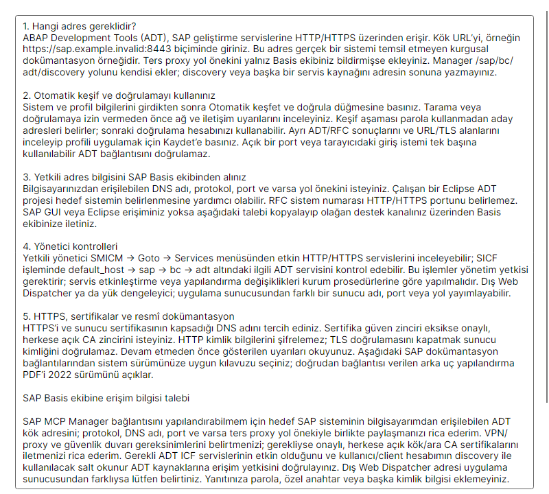

# ADT adresleri, TLS ve tanılama

[Ana sayfa](../README.tr.md) · [Kullanım kılavuzu](USER-GUIDE.tr.md)

## ADT adresini bulup kaydetme

### 1. Hangi adres gereklidir?

ABAP Development Tools (ADT), SAP geliştirme servislerine HTTP/HTTPS üzerinden erişir. Kök URL’yi, örneğin https://sap.example.invalid:8443 biçiminde giriniz. Bu adres gerçek bir sistemi temsil etmeyen kurgusal dokümantasyon örneğidir. Ters proxy yol önekini yalnız Basis ekibiniz bildirmişse ekleyiniz. Manager /sap/bc/adt/discovery yolunu kendisi ekler; discovery veya başka bir servis kaynağını adresin sonuna yazmayınız.

### 2. Otomatik keşif ve doğrulamayı kullanınız

Sistem ve profil bilgilerini girdikten sonra Otomatik keşfet ve doğrula düğmesine basınız. Tarama veya doğrulamaya izin vermeden önce ağ ve iletişim uyarılarını inceleyiniz. Keşif aşaması parola kullanmadan aday adresleri belirler; sonraki doğrulama hesabınızı kullanabilir. Ayrı ADT/RFC sonuçlarını ve URL/TLS alanlarını inceleyip profili uygulamak için Kaydet’e basınız. Açık bir port veya tarayıcıdaki giriş istemi tek başına kullanılabilir ADT bağlantısını doğrulamaz.

### 3. Yetkili adres bilgisini SAP Basis ekibinden alınız

Bilgisayarınızdan erişilebilen DNS adı, protokol, port ve varsa yol önekini isteyiniz. Çalışan bir Eclipse ADT projesi hedef sistemin belirlenmesine yardımcı olabilir. RFC sistem numarası HTTP/HTTPS portunu belirlemez. SAP GUI veya Eclipse erişiminiz yoksa aşağıdaki talebi kopyalayıp olağan destek kanalınız üzerinden Basis ekibinize iletiniz.

### 4. Yönetici kontrolleri

Yetkili yönetici SMICM → Goto → Services menüsünden etkin HTTP/HTTPS servislerini inceleyebilir; SICF işleminde default_host → sap → bc → adt altındaki ilgili ADT servisini kontrol edebilir. Bu işlemler yönetim yetkisi gerektirir; servis etkinleştirme veya yapılandırma değişiklikleri kurum prosedürlerine göre yapılmalıdır. Dış Web Dispatcher ya da yük dengeleyici; uygulama sunucusundan farklı bir sunucu adı, port veya yol yayımlayabilir.

### 5. HTTPS, sertifikalar ve resmî dokümantasyon

HTTPS’i ve sunucu sertifikasının kapsadığı DNS adını tercih ediniz. Sertifika güven zinciri eksikse onaylı, herkese açık CA zincirini isteyiniz. HTTP kimlik bilgilerini şifrelemez; TLS doğrulamasını kapatmak sunucu kimliğini doğrulamaz. Devam etmeden önce gösterilen uyarıları okuyunuz. Aşağıdaki SAP dokümantasyon bağlantılarından sistem sürümünüze uygun kılavuzu seçiniz; doğrudan bağlantısı verilen arka uç yapılandırma PDF’i 2022 sürümünü açıklar.

[SAP ADT dokümantasyonu](https://help.sap.com/docs/ABAP_DEVELOPMENT_TOOLS_FOR_ECLIPSE) · [SAP arka uç yapılandırma kılavuzu (2022)](https://help.sap.com/doc/2e65ad9a26c84878b1413009f8ac07c3/202210.000/en-US/config_guide_system_backend_abap_development_tools.pdf)

### Basis’e gönderilecek talep

SAP Basis ekibine erişim bilgisi talebi

SAP MCP Manager bağlantısını yapılandırabilmem için hedef SAP sisteminin bilgisayarımdan erişilebilen ADT kök adresini; protokol, DNS adı, port ve varsa ters proxy yol önekiyle birlikte paylaşmanızı rica ederim. VPN/proxy ve güvenlik duvarı gereksinimlerini belirtmenizi; gerekliyse onaylı, herkese açık kök/ara CA sertifikalarını iletmenizi rica ederim. Gerekli ADT ICF servislerinin etkin olduğunu ve kullanıcı/client hesabımın discovery ile kullanılacak salt okunur ADT kaynaklarına erişim yetkisini doğrulayınız. Dış Web Dispatcher adresi uygulama sunucusundan farklıysa lütfen belirtiniz. Yanıtınıza parola, özel anahtar veya başka kimlik bilgisi eklemeyiniz.

Kök URL, RFC sistem numarası ve SAP client’tan bağımsızdır. Client/dil/hesabı kendi alanlarında tutun. Açık adtBaseUrl önceliklidir. Sondaki /sap/bc/adt bir kez kaldırılır; discovery yolunu istemci ekler. Query, fragment, gömülü kimlik bilgisi ve alt servis adresleri reddedilir. Ters proxy yol öneki, IPv4/IPv6 ve özel port desteklenir. HTTP’de kimlik bilgileri TLS ile korunmaz; sürekli uyarı gösterilir.

Eski profiller ve DPAPI dosyaları korunur. Advanced otomatik keşif ve doğrulaması kaydedilmemiş formu değerlendirir; profili yalnız Kaydet uygular. Eski adres önerisi kontrolleri ve zaman aşımı alanı arayüzden kaldırılmıştır. Mevcut zaman aşımı/keşif değerleri uyumlu kalır ve profil düzenlenirken korunur.

## Profile sertifika güveni ekleme

Önce profili kaydedip **Profil sertifikaları** ekranını açın. Kök/ara CA veya doğrulanmış self-signed açık sertifikayı Basis’ten güvenilir kanalla alın. PEM/DER (.pem/.cer/.crt) eklerken sahip, düzenleyen, UTC tarihleri, SAN ve SHA-256 değerini inceleyin; parmak izini yöneticinizle doğrulayıp güven referanslarını kaydedin. Açık sertifikalar uygulamanın profile özel veri klasörüne kopyalanır. PFX/özel anahtar kabul edilmez. Referansı kaldırmak sonraki çağrılardaki güveni kaldırır; kullanılmayan açık dosyalar diskte kalabilir, kendiliğinden güvenilmez.

Güven; Node varsayılanları, mevcut başlangıç ek CA’ları, Windows güveni ve yalnız bu profilin dosyalarından oluşur. Burada CA eklemek Windows’a veya başka profile ekleme yapmaz. Ara sertifikalar zinciri tamamlar, tek başına kök olmaz. DNS/IP SAN ve tarihler yine eşleşmelidir. Başka sunucu adına düzenlenmiş güvenilir self-signed sertifika da reddedilir. Eksik dosya, değişmiş parmak izi ve bozuk dosya bağlantıyı engeller.

**Sunucu sertifikasını incele (giriş yapmadan)**, hesap bilgisi göndermeden veya güven vermeden doğrulanmamış metadata döndürür. Yalnız bu inceleme için güvenilmeyen TLS el sıkışmasına izin verilir. Güven eklemek için doğrulanmış dosya kullanın; sertifikaya ağdan geldiği için güvenmeyin. Ağ/TLS protokolü çalışmıyorsa incelemede metadata alınamayabilir.

Gelişmiş TLS atlama seçeneği yalnız bu profile aittir, yeni profillerde kapalıdır ve sürekli uyarılır. Bu, doğrulanmış güvenli bağlantı değildir. Genel TLS kapatma işlemi yoktur. Kalıcı çözüm doğru sertifika güvenidir.

## Kaydedilmiş seçili profili test etme

**ADT bağlantısını test et**, aktif olmayan profil dahil kaydedilmiş seçili profili SapMcpHost ve gerçek MCP aktarımıyla sınar. Geçici özel mapping yalnız şifre referansları taşır; Codex/Claude ortak aktif hesabı değişmez. Kaydedilmemiş alanları önce kaydedin. Preview.4 bağlantı yeteneği olmayan eski ADT paketleri kur/onar mesajıyla engellenir.

Aşamalar: yapılandırma → DNS/TCP → HTTPS için TLS → kimlik doğrulama → ADT discovery → salt okunur compatibility graph. Beklenen XML namespace/yapıları gerekir. Açık port, 401, herhangi bir XML/HTML veya kök 404 yeterli değildir. Kök 404 tek başına ADT yok demek değildir. Anonim kaynaklar girilen hesabı kanıtlamaz; sonuç doğrulanmamış kalır. İlk hatalı kimlik denemesi testi ve otomatik tekrarları durdurur; değişmemiş yanlış şifreyle tekrar tekrar denemeyin.

DNS, kapalı TCP, timeout, TLS ad/tarih/güven/zincir, 401 kimlik doğrulama, 403 yetki ve servis/içerik hataları ayrılır. Eksik düzenleyen ile eksik güven kökü her zaman kesin ayrılamaz: TLS_CHAIN_UNRESOLVED bunu belirtir. Genel TLS’yi kapatmak yerine Basis’ten tam zincir ve yönlendirmeyi kontrol etmesini isteyin.

Mevcut HTTP_PROXY/HTTPS_PROXY/ALL_PROXY/NO_PROXY değişkenleri kullanılır; HTTP proxy aktarımı ve HTTPS CONNECT ortak katmandan geçer. Manager proxy URL/şifresini veya işletim sistemi ortamını yeniden yazmaz. Proxy varsa ağ aşamaları etkin yola aittir; uç sunucunun TLS’si yine doğrulanır. Etkileşimli proxy kimlik doğrulaması, SSO/mTLS ve yeni proxy yönetim ekranı sağlanmaz.

Profil/sertifika değişikliği sonraki çağrıda okunur; yalnız hedefe göre URL önbelleği ayarı ezemez. Yeni ADT paketi kurunca, Node/ortam veya Windows güvenini değiştirince istemcide MCP’leri yeniden başlatın. Güncellemede ayarlar, profiller, DPAPI şifreleri ve istemci kayıtları korunur.

## Destek, test ve sınırlar

Tanılama ekranından maskelenmiş destek raporu çıkarın. Yalnız izinli aşama/durum/kod ve maskelenmiş yapılandırma bulunur; adres, hesap, sertifika kimliği, token, şifre, cookie, header veya ham gövde yoktur. Gerçek mapping, CA dosyaları, native trace veya PATH’i public kayıtlara eklemeyin.

Yerel kurgusal HTTP/TLS testleri profil yalıtımı, zincir, self-signed, SAN/tarih, redirect, proxy, kimlik ve yanıltıcı içerik senaryolarını kapsar. Manager/Host/MCP tutarlılığı canlı SAP olmadan yerel sunucuda sınanır. Native klavye/erişilebilirlik, temiz Windows/GUI’siz kurulum ve yetkili müşteri/canlı SAP kabulü yapılana kadar bekler. Otomatik OCSP/CRL/AIA, SSO/mTLS ve SAP tarafında servis/sertifika değiştirme bu teslimde yoktur. Windows/Node güven kuralları tarayıcı/Eclipse ile aynı değildir; yalnız tarayıcıda açılması MCP güvenini kanıtlamaz.

