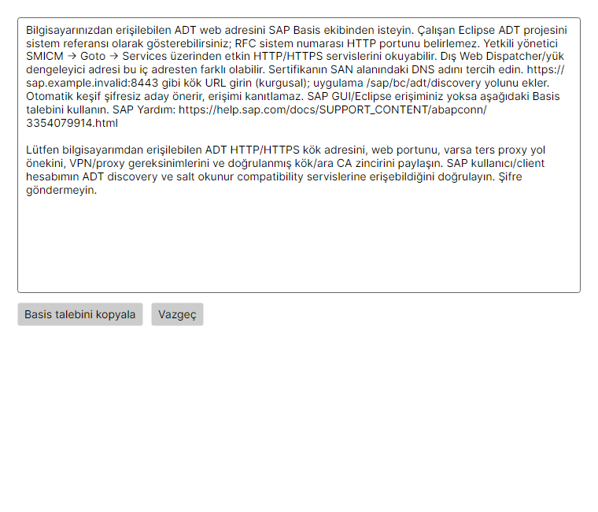

# ADT adresleri, TLS ve tanılama

[Ana sayfa](../README.tr.md) · [Kullanım kılavuzu](USER-GUIDE.tr.md)

## ADT adresini bulup kaydetme

Bilgisayarınızdan erişilebilen ADT web adresini SAP Basis ekibinden isteyin. Çalışan Eclipse ADT projesini sistem referansı olarak gösterebilirsiniz; RFC sistem numarası HTTP portunu belirlemez. Yetkili yönetici SMICM → Goto → Services üzerinden etkin HTTP/HTTPS servislerini okuyabilir. Dış Web Dispatcher/yük dengeleyici adresi bu iç adresten farklı olabilir. Sertifikanın SAN alanındaki DNS adını tercih edin. https://sap.example.invalid:8443 gibi kök URL girin (kurgusal); uygulama /sap/bc/adt/discovery yolunu ekler. Otomatik keşif şifresiz aday önerir, erişimi kanıtlamaz. SAP GUI/Eclipse erişiminiz yoksa aşağıdaki Basis talebini kullanın. SAP Yardım: https://help.sap.com/docs/SUPPORT_CONTENT/abapconn/3354079914.html

### Basis’e gönderilecek talep

Lütfen bilgisayarımdan erişilebilen ADT HTTP/HTTPS kök adresini, web portunu, varsa ters proxy yol önekini, VPN/proxy gereksinimlerini ve doğrulanmış kök/ara CA zincirini paylaşın. SAP kullanıcı/client hesabımın ADT discovery ve salt okunur compatibility servislerine erişebildiğini doğrulayın. Şifre göndermeyin.

Kök URL, RFC sistem numarası ve SAP client’tan bağımsızdır. Client/dil/hesabı kendi alanlarında tutun. Açık adtBaseUrl önceliklidir. Sondaki /sap/bc/adt bir kez kaldırılır; discovery yolunu istemci ekler. Query, fragment, gömülü kimlik bilgisi ve alt servis adresleri reddedilir. Ters proxy yol öneki, IPv4/IPv6 ve özel port desteklenir. HTTP’de kimlik bilgileri TLS ile korunmaz; sürekli uyarı gösterilir.

Eski profiller ve DPAPI dosyaları korunur. Eski boş URL artık şifreyle port tahmini başlatmaz: önce doğrulanmış URL seçip kaydedin. İçe aktarılmış eski adres listeleri profil verisinde kalır; açık alan boşsa ilk tanımlı adres kullanılır. Adres önerisi isteğe bağlı, yalnız hedef sunucuya yönelik ve kimlik bilgisizdir. 401/404 dahil aday yanıtları ADT varlığını kanıtlamaz. Seçim URL’yi forma alır; testten önce kaydedin.

## Profile sertifika güveni ekleme

Önce profili kaydedip **Profil sertifikaları** ekranını açın. Kök/ara CA veya doğrulanmış self-signed açık sertifikayı Basis’ten güvenilir kanalla alın. PEM/DER (.pem/.cer/.crt) eklerken sahip, düzenleyen, UTC tarihleri, SAN ve SHA-256 değerini inceleyin; parmak izini yöneticinizle doğrulayıp güven referanslarını kaydedin. Açık sertifikalar uygulamanın profile özel veri klasörüne kopyalanır. PFX/özel anahtar kabul edilmez. Referansı kaldırmak sonraki çağrılardaki güveni kaldırır; kullanılmayan açık dosyalar diskte kalabilir, kendiliğinden güvenilmez.

Güven; Node varsayılanları, mevcut başlangıç ek CA’ları, Windows güveni ve yalnız bu profilin dosyalarından oluşur. Burada CA eklemek Windows’a veya başka profile ekleme yapmaz. Ara sertifikalar zinciri tamamlar, tek başına kök olmaz. DNS/IP SAN ve tarihler yine eşleşmelidir. Başka sunucu adına düzenlenmiş güvenilir self-signed sertifika da reddedilir. Eksik dosya, değişmiş parmak izi ve bozuk dosya bağlantıyı engeller.

**Sunucu sertifikasını incele (giriş yapmadan)**, hesap bilgisi göndermeden veya güven vermeden doğrulanmamış metadata döndürür. Yalnız bu inceleme için güvenilmeyen TLS el sıkışmasına izin verilir. Güven eklemek için doğrulanmış dosya kullanın; sertifikaya ağdan geldiği için güvenmeyin. Ağ/TLS protokolü çalışmıyorsa incelemede metadata alınamayabilir.

Gelişmiş TLS atlama seçeneği yalnız bu profile aittir, yeni profillerde kapalıdır ve sürekli uyarılır. Bu, doğrulanmış güvenli bağlantı değildir. Genel TLS kapatma işlemi yoktur. Kalıcı çözüm doğru sertifika güvenidir.

## Kaydedilmiş seçili profili test etme

**ADT bağlantısını test et**, aktif olmayan profil dahil kaydedilmiş seçili profili SapMcpHost ve gerçek MCP aktarımıyla sınar. Geçici özel mapping yalnız şifre referansları taşır; Codex/Claude ortak aktif hesabı değişmez. Kaydedilmemiş alanları önce kaydedin. Preview.4 bağlantı yeteneği olmayan eski ADT paketleri kur/onar mesajıyla engellenir.

Aşamalar: yapılandırma → DNS/TCP → HTTPS için TLS → kimlik doğrulama → ADT discovery → salt okunur compatibility graph. Beklenen XML namespace/yapıları gerekir. Açık port, 401, herhangi bir XML/HTML veya kök 404 yeterli değildir. Kök 404 tek başına ADT yok demek değildir. Anonim kaynaklar girilen hesabı kanıtlamaz; sonuç doğrulanmamış kalır. İlk hatalı kimlik denemesi testi ve otomatik tekrarları durdurur; değişmemiş yanlış şifreyle tekrar tekrar denemeyin.

DNS, kapalı TCP, timeout, TLS ad/tarih/güven/zincir, 401 kimlik doğrulama, 403 yetki ve servis/içerik hataları ayrılır. Eksik düzenleyen ile eksik güven kökü her zaman kesin ayrılamaz: TLS_CHAIN_UNRESOLVED bunu belirtir. Genel TLS’yi kapatmak yerine Basis’ten tam zincir ve yönlendirmeyi kontrol etmesini isteyin.

Mevcut HTTP_PROXY/HTTPS_PROXY/ALL_PROXY/NO_PROXY değişkenleri kullanılır; HTTP proxy aktarımı ve HTTPS CONNECT ortak katmandan geçer. Manager proxy URL/şifresini veya işletim sistemi ortamını yeniden yazmaz. Proxy varsa ağ aşamaları etkin yola aittir; uç sunucunun TLS’si yine doğrulanır. Etkileşimli proxy kimlik doğrulaması, SSO/mTLS ve yeni proxy yönetim ekranı sağlanmaz.

Profil/sertifika değişikliği sonraki çağrıda okunur; yalnız hedefe göre URL önbelleği ayarı ezemez. Yeni ADT paketi kurunca, Node/ortam veya Windows güvenini değiştirince istemcide MCP’leri yeniden başlatın. Güncellemede ayarlar, profiller, DPAPI şifreleri ve istemci kayıtları korunur.

## Destek, test ve sınırlar

Tanılama ekranından maskelenmiş destek raporu çıkarın. Yalnız izinli aşama/durum/kod ve maskelenmiş yapılandırma bulunur; adres, hesap, sertifika kimliği, token, şifre, cookie, header veya ham gövde yoktur. Gerçek mapping, CA dosyaları, native trace veya PATH’i public kayıtlara eklemeyin.

Yerel kurgusal HTTP/TLS testleri profil yalıtımı, zincir, self-signed, SAN/tarih, redirect, proxy, kimlik ve yanıltıcı içerik senaryolarını kapsar. Manager/Host/MCP tutarlılığı canlı SAP olmadan yerel sunucuda sınanır. Native klavye/erişilebilirlik, temiz Windows/GUI’siz kurulum ve yetkili müşteri/canlı SAP kabulü yapılana kadar bekler. Otomatik OCSP/CRL/AIA, SSO/mTLS ve SAP tarafında servis/sertifika değiştirme bu teslimde yoktur. Windows/Node güven kuralları tarayıcı/Eclipse ile aynı değildir; yalnız tarayıcıda açılması MCP güvenini kanıtlamaz.

