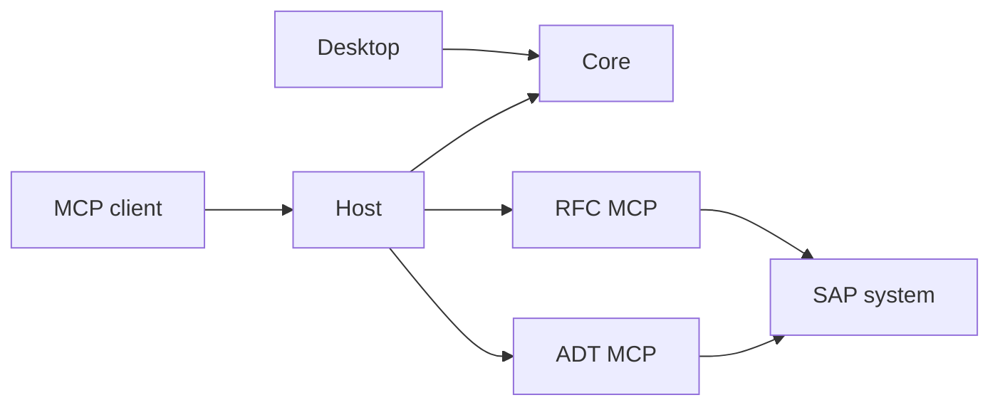

# SAP MCP Manager — application architecture

[Türkçe](ARCHITECTURE.tr.md) · [Developer guide](DEVELOPMENT.md) · [Home](../README.md)

This document describes application components, data flow and compatibility boundaries.
It is versioned alongside source on the same Git branch. Technical changes update this
document and developer guides in the corresponding PR. Agent operating instructions
and machine-specific access paths are separate from application architecture.

## Components and dependencies

| Component | Responsibility |
|---|---|
| `src/SapMcp.Desktop` | Avalonia/.NET 10 desktop UI, Basic/Advanced setup flows and user consent. References `SapMcp.Core`. |
| `src/SapMcp.Core` | Schema-1 settings, connection sources/profiles, DPAPI secrets, prerequisites, package verification, client config merging and redacted logs. |
| `src/SapMcp.Host` | UI-independent MCP launcher; uses Core to read current settings, build child-process environments, proxy stdio and enforce RFC readiness policy. |
| Private RFC MCP | RFC tools and the Python/PyRFC worker in the separate `SAP_RFC_MCP` repository. |
| Private ADT MCP | ADT tools, HTTP/TLS and discovery in the separate `sap_adt_mcp` repository. |
| `scripts/`, `installer/`, `payload/` | Payload preparation, builds, verification and Online/Offline EXEs from authorized sources and pinned inputs. |

Desktop manages installation and configuration. The MCP client launches Host as a
separate process; Desktop does not need to remain open. Both Host and Desktop reference
Core. Generated Manager payload is not a substitute for editing private MCP source.
Cross-repository changes record tested source commits, package versions and compatibility
dependencies in PRs and release evidence.

## Configuration and data boundaries

`AppSettings` uses schema version 1. Optional language, UI-mode and connection-source
fields preserve older records. Schema/DPAPI changes are checked against existing user
settings. Real user data, secrets and generated output stay outside Git.

Connection sources use a common reader interface. External SAP GUI XML is read-only;
managed JSON provides validated CRUD and generates owned XML for MCPs. Saved source mode
takes priority over detection suggestions. Active profile/mapping preserve `target_key`
and `secretRef` compatibility; password files remain outside the catalog.

Saving stages and serializes changes, then rolls back catalog, mapping, XML and settings
on write failure or cancellation. This is exception recovery, not a crash-proof multi-file
database transaction. DPAPI secrets are not portable credentials for another Windows
account or computer.

## Runtime flows

Basic draft saving and network verification are separate operations.
`BasicConnectionService` coordinates consent, RFC readiness, candidate discovery and
verification. `BasicDiscoveryService` runs the packaged ADT discovery entry in Node;
it checks package capabilities, input/output protocol, time limits and candidate targets.
Readiness is not established solely by a file existing or a TCP port being open.
The [Basic guide](BASIC-SETUP.md) documents current behavior and network scope.

Host constructs its environment from current settings at each launch. RFC readiness
includes SDK checks and Python/PyRFC native loading. When unavailable, RFC-dependent
ADT operations are blocked before forwarding. MCP tool names and parameter contracts
are preserved. stdout is reserved for protocol traffic; diagnostics and redacted logs
are separate. Child-process environment settings do not modify permanent user/system
environment variables.

Client integration previews and applies changes to the relevant JSON/TOML configuration,
preserving unrelated settings and unselected server entries. Active profiles and current
verification determine which MCP components are eligible for registration.

## UI and localization

Core's `Resources/Strings.json` is the shared English/Turkish catalog. Stable UI keys are
separate from MCP diagnostic IDs. Language/mode switches preserve open forms and user
input; user-entered TextBox content is not localized. User-facing behavior and guides
are updated in both languages.

## Packaging and verification

Public builds use Windows x64 and .NET SDK 10 without private repositories, SDK or SAP
credentials. The source-built UI can open without payload and reports missing packages
in installation checks. Complete EXEs require authorized private sources and approved
PyRFC inputs. SAP NetWeaver RFC SDK is not distributed. Payload preparation preserves
pinned versions/hashes and `build-info.json` provenance.

Core/headless UI tests, public CI and publication scanning live in the source repository.
Host integration, installer tests, clean Windows and live SAP acceptance provide separate
evidence; passing one does not establish that another was performed. Commands and release
steps are in the [developer guide](DEVELOPMENT.md).
