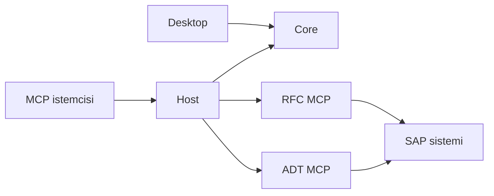

# SAP MCP Manager — uygulama mimarisi

[English](ARCHITECTURE.md) · [Geliştirici kılavuzu](DEVELOPMENT.tr.md) · [Ana sayfa](../README.tr.md)

Bu belge uygulamanın bileşenlerini, veri akışını ve uyumluluk sınırlarını tanımlar.
Kaynak kodla aynı Git dalında sürümlenir; teknik kararlar ilgili değişikliğin PR'ında
bu belge ve geliştirici kılavuzlarıyla birlikte güncellenir. Agent çalışma talimatları
ve bilgisayara özel erişim yolları uygulama mimarisinin parçası değildir.

## Bileşenler ve bağımlılıklar

| Bileşen | Sorumluluk |
|---|---|
| `src/SapMcp.Desktop` | Avalonia/.NET 10 masaüstü arayüzü, Basic/Advanced kurulum akışları ve kullanıcı onayları. `SapMcp.Core` kullanır. |
| `src/SapMcp.Core` | Şema-1 ayarlar, bağlantı kaynakları/profiller, DPAPI sırları, ön koşullar, paket doğrulama, istemci ayarı birleştirme ve maskeli loglar. |
| `src/SapMcp.Host` | Arayüzden bağımsız MCP başlatıcısı; Core ile güncel ayarları okur, alt süreç ortamını kurar, stdio trafiğini aktarır ve RFC hazırlık politikasını uygular. |
| Özel RFC MCP | Ayrı `SAP_RFC_MCP` deposunda RFC araçları ve Python/PyRFC işçisi. |
| Özel ADT MCP | Ayrı `sap_adt_mcp` deposunda ADT araçları, HTTP/TLS ve keşif davranışı. |
| `scripts/`, `installer/`, `payload/` | Onaylı kaynak ve sabit sürümlü girdilerden paket hazırlama, derleme, doğrulama ve Online/Offline EXE üretimi. |

Desktop kurulum ve yapılandırma yönetir. MCP istemcisi Host'u ayrı bir süreç olarak
başlatır; Desktop'ın açık kalması gerekmez. Host ve Desktop aynı Core kitaplığını kullanır.
Manager deposundaki üretilmiş payload, özel MCP kaynak kodunun yerine düzenlenmez.
Birden fazla depoya yayılan değişiklikte test edilen kaynak commit'leri, paket sürümleri
ve uyumluluk bağımlılığı PR ve yayın kanıtında kaydedilir.

## Yapılandırma ve veri sınırları

`AppSettings` şema sürümü 1'dir. Dil, arayüz modu ve bağlantı kaynağına ait isteğe bağlı
alanlar eski kayıtların okunabilirliğini korur. Şema/DPAPI değişiklikleri eski kullanıcı
ayarlarıyla doğrulanır. Gerçek kullanıcı verisi, sırlar ve çalışma çıktıları Git'e girmez.

Bağlantı kaynakları ortak okuyucu arayüzünü kullanır. Dış SAP GUI XML'i salt okunurdur;
yönetilen JSON doğrulanan CRUD işlemleri sunar ve MCP'ler için uygulamaya ait XML üretir.
Kaydedilmiş kaynak modu algılama önerisine göre önceliklidir. Aktif profil ve mapping,
`target_key`/`secretRef` uyumunu korur; şifre dosyaları katalog dışında tutulur.

Kayıt işlemi hazırlanan içerikleri sıraya alır; yazma veya iptal hatasında katalog,
mapping, XML ve ayarları geri alır. Bu, hata geri almadır; çökme dayanıklı çok dosyalı
veritabanı transaction garantisi değildir. DPAPI sırları başka Windows hesabına veya
bilgisayara taşınabilir kimlik bilgisi olarak değerlendirilmez.

## Çalışma zamanı akışları

Basic akışında bağlantı taslağını kaydetmek ile ağı doğrulamak ayrı işlemlerdir.
`BasicConnectionService` onayları, RFC hazırlığını, aday keşfini ve aday doğrulamasını
koordine eder. `BasicDiscoveryService`, ADT paketindeki keşif girişini Node sürecinde
çalıştırır; paket yeteneğini, giriş/çıktı protokolünü, süre sınırını ve aday hedeflerini
kontrol eder. Uygunluk yalnız dosya varlığına veya açık TCP portuna indirgenmez.
Güncel akış ve ağ kapsamı [Basic kılavuzunda](BASIC-SETUP.tr.md) açıklanır.

Host her başlangıçta güncel ayarlardan ortam üretir. RFC için SDK kontrolü yanında
Python/PyRFC native yüklemesi değerlendirilir. RFC hazır değilse ona bağımlı ADT
işlemleri iletilmeden engellenir. MCP araç adları ve parametre sözleşmeleri korunur.
stdout protokol içindir; tanılama ve maskeli loglar ayrı tutulur. Ortam ayarlarının
alt süreçlere aktarılması kalıcı kullanıcı/sistem ortamını değiştirmez.

İstemci entegrasyonu ilgili JSON/TOML dosyasını önizleme ve uygulama akışıyla günceller;
ilgisiz ayarlar ve seçilmemiş sunucu girdileri korunur. Aktif profil ve güncel doğrulama
hangi MCP bileşeninin kaydedilebileceğini belirler.

## Arayüz ve yerelleştirme

Core içindeki `Resources/Strings.json` ortak İngilizce/Türkçe kaynaktır. Sabit arayüz
anahtarları MCP teşhis kimliklerinden ayrıdır. Dil/mod değişimi açık formu yeniden
oluşturup kullanıcı girdisini silmez; kullanıcının TextBox içeriği yerelleştirilmez.
Kullanıcıya görünen davranış ve kılavuzlar iki dilde birlikte güncellenir.

## Paketleme ve doğrulama

Public derleme Windows x64 ve .NET SDK 10 kullanır; özel depo, SDK veya SAP hesabı
gerektirmez. Kaynaktan arayüz payload olmadan açılabilir; eksik paketler kurulum
kontrollerinde bildirilir. Tam EXE üretimi yetkili özel kaynakları ve onaylı PyRFC
girdisini gerektirir. SAP NetWeaver RFC SDK dağıtılmaz. Sabit sürüm/hashler ve
`build-info.json` kaynak kayıtları paket hazırlamada korunur.

Core ve headless UI testleri, public CI ve yayın içeriği taraması kaynak deposunda
yürütülür. Host entegrasyonu, kurulum testleri, temiz Windows ve canlı SAP kabulü
ayrı kanıtlardır; birinin başarısı diğerinin yapıldığı anlamına gelmez. Komutlar ve
yayın adımları [geliştirici kılavuzundadır](DEVELOPMENT.tr.md).

## Preview.14: ortak değerlendirme ve OpenCode

Basic ve Advanced aynı keşif/doğrulama motorunu kullanır. `EvaluateAsync` geçici ayar, mapping ve DPAPI sırlarıyla çalışır; profil kaydetmeden veya harici bağlantı kaynağını değiştirmeden sonuç döndürür. Basic mevcut kayıt yolunu korur. Advanced yalnız geçerli formu doldurur ve Kaydet bekler; form değişikliği sonucu geçersiz kılar. Ağ erişimi açık onay gerektirir.

OpenCode yerel stdio istemci hedefidir. Şema-1 ayarlara isteğe bağlı tercihler eklenir; registration istemci adı `OpenCode` kalır. V1 ve V2 farklı MCP yerleşimleri kullanır. JSONC düzenlemesi yalnız hedef özellik aralıklarını değiştirir; ilgisiz ayarlar ve agent talimatları korunur. Önizleme, çakışma onayı, eşzamanlı düzenleme kontrolü, yedekleme ve sahipliğe göre kaldırma diğer istemcilerle ortaktır.
