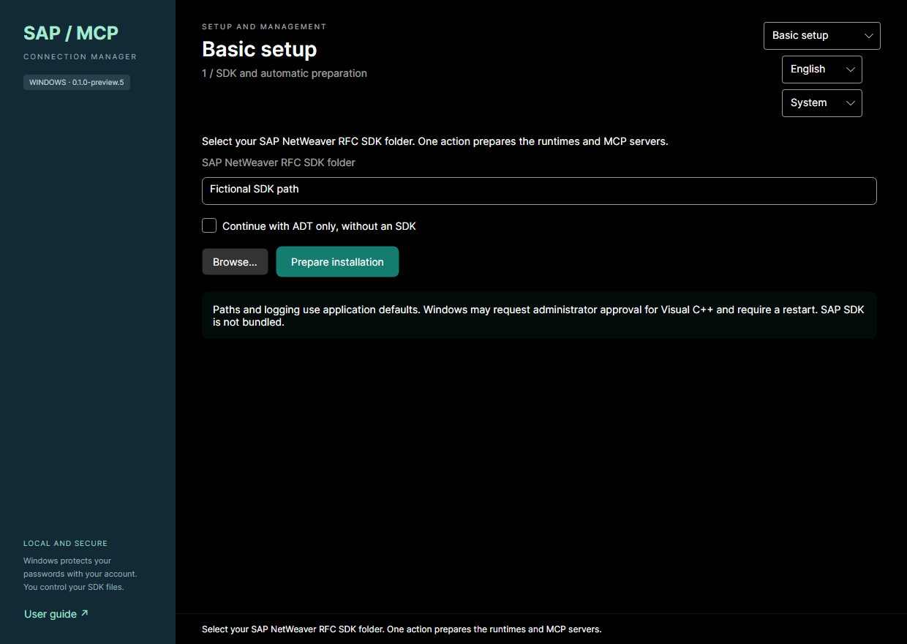

# Basic and Advanced setup

[Home](../README.md) · [Türkçe](BASIC-SETUP.tr.md)

New installations open Basic. Existing configurations open Advanced; your choice is remembered. Use the top mode selector to switch. Existing Advanced pages retain their layout and behavior. Unsaved form values survive mode/language changes; no account is saved just by switching mode. Basic and Advanced share the connection catalog, profiles, DPAPI files and active account per system.

## 1. SDK and automatic preparation

Select the SAP NetWeaver RFC SDK folder, then **Prepare installation**. The application checks prerequisites, installs missing managed runtimes and current MCP packages, validates the SDK and performs local MCP initialization/tools-list checks. There is no second MCP installation button. Existing compatible packages are reused. Windows may request UAC for Visual C++ and a restart. SDK files must be supplied by you; they are never bundled.

If you do not have an SDK, select **Continue with ADT only, without an SDK**. ADT can proceed while RFC is shown as unavailable. Missing RFC dependencies or invalid SDK cannot become RFC success. Node/DPAPI/storage failures still block preparation. Paths, mapping and log settings use application defaults on new installations; existing customized settings remain available in Advanced.

## 2. One SAP connection

Choose an existing account or create one. Enter the application server (DNS/IPv4/IPv6, optional HTTPS port), user, password, client, SAP language and two-digit instance number. A blank password preserves the chosen account's saved secret. A new account requires a password. Basic stores it using the existing CurrentUser DPAPI format, not plaintext. It does not change your SAP password.

After the server or manual address changes, a 500 ms debounce starts an unauthenticated HTTPS search. Priority: explicit port, then 443/44300/44301/44302, then remaining 44300–44399 ports. Defaults are centralized: at most 16 concurrent probes, 1.5 seconds per probe and 15 seconds total, including DNS/TLS/HTTP. Slow or uncommon services can fall outside this bounded search; failure does not prove ADT is absent. No HTTP fallback, authorization headers, SAP cookies or redirect following is used. Changing server cancels prior work and invalidates old results.

Only a 200 response with the expected ADT discovery structure is a confirmed discovery. 401 is an authentication-required candidate, not success. HTML, arbitrary XML, 403 and redirects are separate outcomes. A confirmed discovery cancels remaining probes. Enter a manual HTTPS URL or port under **Enter an ADT address / port** when needed; that address takes precedence and is checked alone. Reverse proxy prefixes are supported; do not enter the deeper discovery service URL.

**How do I find the ADT port or address?** Ask Basis for the workstation-accessible HTTPS base URL/port, VPN/proxy requirements and verified public CA chain. An authorized administrator can inspect **SMICM → Goto → Services** in SAP GUI. The Web Dispatcher address can differ from the application server; explicitly enter that external URL if used. RFC instance number alone does not determine the web address. The field help includes a copyable Basis request. See the full [ADT/TLS guide](ADT-CONNECTIONS.md).

TLS chain, dates and DNS/IP name must validate. On a certificate problem, **Profile certificates** lets you inspect a public PEM/DER file and explicitly confirm its identity/fingerprint for this draft/profile. It never trusts a certificate just because it was received over the network; trust is not global and does not fix wrong names or dates. Basic does not allow TLS bypass. Existing Advanced certificate tools remain available.

Press **Save and verify**. Secure candidates are authenticated sequentially, never in parallel. The first explicit rejected login stops remaining candidate and RFC login attempts; correct credentials before retrying. Manager tests the real ADT MCP transport including discovery and a read-only compatibility request; anonymous access does not prove the supplied account. RFC is separately tested with the existing RFC_PING tool. If ADT fails for service/network/TLS reasons, RFC can still be tested. Ping success is not authorization for every RFC function.

An entered instance is used as-is. A same-server 443NN port can supply a tentative instance only; RFC ping must confirm connectivity. If no unique candidate exists, enter the two-digit instance; Basic never silently assumes 00. A Web Dispatcher port does not infer the application-server instance.

- Both verified: profile saved and full connection success shown.
- One verified: profile saved with separate results and a partial-completion warning; only the working MCP is offered to clients.
- Neither verified: stay on the connection step; previous profile/active mapping is preserved. Fix the settings and retry. Draft test files/secrets are cleaned up.

Tests use isolated temporary mappings and do not switch other clients' accounts. Successful save updates the shared active profile for that target. Other accounts/systems remain. Existing SAP GUI sources require an explicit, previewed conversion to a managed catalog before Basic editing; supported entries are preserved, source XML stays unchanged, unsupported/include/SNC/message-server entries stop conversion. Choose Advanced if conversion is unsuitable.

## 3. Codex / Claude Desktop

Review and apply the existing client integration. Only the independently verified components are included; unrelated registrations and backups/conflict handling are preserved. Existing unselected registrations are not automatically deleted. Connection changes invalidate the old verification. Restart the clients' MCP processes after installation/package changes. Clients start the existing Host on demand; no persistent Windows service is added and Manager need not stay open.

This preview is unsigned. Clean Windows and live SAP acceptance remain pending; local synthetic tests do not establish that every SAP installation is compatible. See release validation for actual outcomes and remaining limits.

## Preview.5 host-only discovery error (fixed in Preview.6)

Preview.5 could stop before any network request when the server was entered without a port. Manager sent an optional port as JSON `null`; the ADT discovery process incorrectly rejected it as `DISCOVERY_PORT_INVALID`. A generic message made this look like a network/certificate problem. RFC uses a separate path and could still pass. This failure did not establish whether ADT was reachable.

Upgrade Manager to Preview.6, then use **Prepare installation** in Basic or install/repair ADT in Advanced to install the updated ADT package. Restart client MCP processes. Existing profiles, DPAPI passwords and RFC packages are preserved. Manager now omits absent optional fields; the updated ADT package also accepts legacy null fields. Input/process errors show a specific safe code instead of claiming a remote network failure.

Retry the saved connection. For a known endpoint, **Enter an ADT address / port** takes priority over scanning. Ask Basis for the actual workstation-accessible HTTPS base URL if needed; the RFC instance number does not establish a web port. An IP address may not match the certificate's DNS name: use the approved matching DNS address and profile CA trust when required. Do not disable TLS validation. This fix does not prove a live system is reachable; VPN, ports, TLS and permissions still require validation. See [issue #6](https://github.com/tamerinal/sap_mcp_windows/issues/6).
