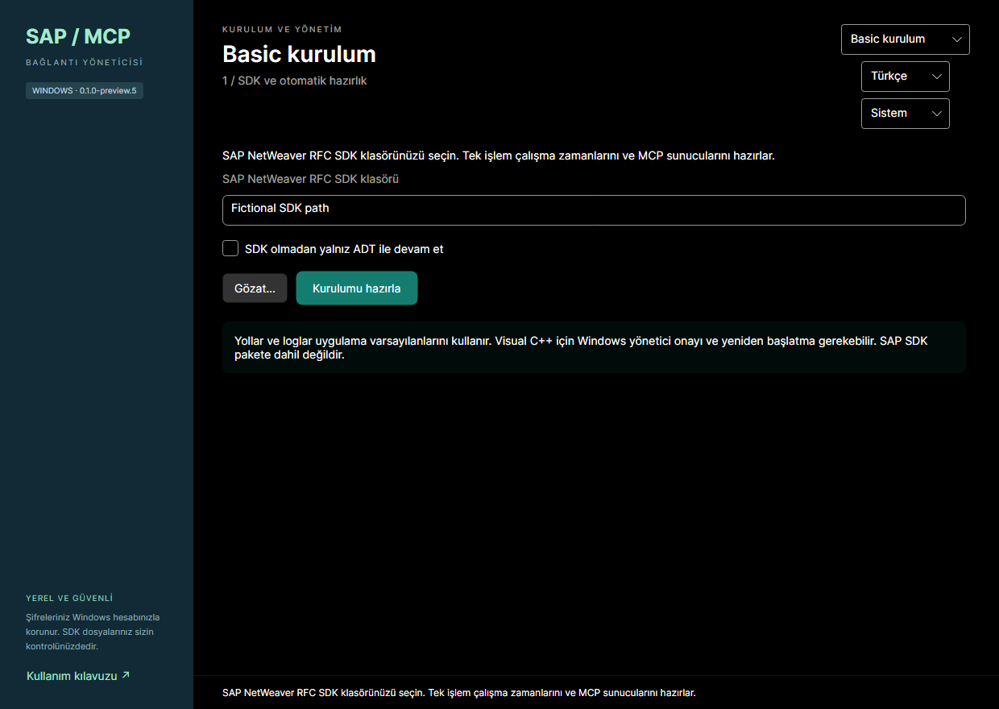

# Basic ve Advanced kurulum

[Ana sayfa](../README.tr.md) · [English](BASIC-SETUP.md)

Yeni kurulum Basic, mevcut yapılandırma Advanced ile açılır; seçiminiz hatırlanır. Üst bölümden mod değiştirilir. Advanced’in mevcut ekranları ve davranışı korunur. Açık form değerleri mod/dil değişiminde kaybolmaz; mod değiştirmek hesap kaydetmez. İki mod aynı bağlantı kataloğunu, profilleri, DPAPI dosyalarını ve sistem başına ortak aktif hesabı kullanır.

## 1. SDK ve otomatik hazırlık

SAP NetWeaver RFC SDK klasörünü seçip **Kurulumu hazırla** düğmesine basın. Ön koşullar kontrol edilir, eksik yönetilen çalışma zamanları/güncel MCP paketleri kurulur, SDK doğrulanır ve yerel MCP başlangıcı/araç listesi sınanır. İkinci bir MCP kur düğmesi yoktur. Uyumlu paketler tekrar kurulmaz. Visual C++ için Windows UAC onayı ve yeniden başlatma gerekebilir. SDK kullanıcı tarafından sağlanır; kuruluma eklenmez.

SDK yoksa **SDK olmadan yalnız ADT ile devam et** seçin. ADT ilerleyebilir; RFC kullanılamaz gösterilir. Eksik RFC bağımlılığı veya bozuk SDK başarıya dönüşmez. Node/DPAPI/disk sorunları hazırlığı durdurur. Yeni kurulumda dosya/mapping/log yolları varsayılandır; mevcut özel ayarlar korunur ve Advanced’te yönetilir.

## 2. Tek SAP bağlantısı

Mevcut hesabı seçin veya yeni bağlantı oluşturun. Uygulama sunucusu (DNS/IPv4/IPv6, isteğe bağlı HTTPS portu), kullanıcı, şifre, client, SAP dili ve iki haneli instance numarası girin. Seçilen mevcut hesapta boş şifre kayıtlı şifreyi korur; yeni hesap şifre gerektirir. Şifre mevcut CurrentUser DPAPI deposunda korunur, düz metin kaydedilmez. SAP sistemindeki gerçek parolayı değiştirmez.

Sunucu/manuel adres değişiminden 500 ms sonra şifresiz HTTPS keşfi başlar. Sıra: açık port, 443/44300/44301/44302, kalan 44300–44399 portları. Merkezi varsayılanlar en fazla 16 paralel kontrol, kontrol başına 1,5 saniye ve DNS/TLS/HTTP dahil toplam 15 saniyedir. Yavaş veya farklı porttaki servis bu sınırlı aramada bulunamayabilir; bu ADT’nin olmadığını kanıtlamaz. HTTP’ye geçilmez, SAP kimliği/çerez gönderilmez, redirect izlenmez. Sunucu değişince önceki işlem iptal edilir ve eski sonuç kullanılmaz.

Yalnız beklenen ADT discovery yapısını taşıyan 200 yanıtı discovery doğrulamasıdır. 401 giriş isteyen adaydır, başarı değildir. HTML, rastgele XML, 403 ve yönlendirmeler ayrıdır. Geçerli discovery bulunduğunda kalan kontroller iptal edilir. **ADT adresi / portu gir** bölümüne manuel HTTPS URL veya port girilebilir; açık adres önceliklidir ve tek başına kontrol edilir. Ters proxy öneki desteklenir; discovery alt servis URL’sini girmeyin.

**ADT portu veya adresi nasıl bulunur?** Basis ekibinden bilgisayarınızdan erişilebilir HTTPS kök adresi/portu, VPN/proxy gereksinimleri ve doğrulanmış public CA zincirini isteyin. Yetkili yönetici SAP GUI’de **SMICM → Goto → Services** ile etkin servisleri okuyabilir. Web Dispatcher adresi uygulama sunucusundan farklı olabilir; bu dış adresi açıkça girin. RFC instance numarası web adresini tek başına belirlemez. Alan yardımında kopyalanabilir Basis talebi bulunur. Ayrıntılar [ADT/TLS kılavuzunda](ADT-CONNECTIONS.tr.md).

TLS zinciri, tarih ve DNS/IP adı doğrulanmalıdır. Sertifika sorununda **Profil sertifikaları** ile public PEM/DER dosyasını inceleyip kimlik/parmak izini açıkça onaylayarak bu taslağa/profile ekleyebilirsiniz. Ağdan geldiği için otomatik güven verilmez; güven global değildir, yanlış ad veya süre sorununu çözmez. Basic TLS doğrulamasını atlamaz. Advanced sertifika araçları korunur.

**Kaydet ve doğrula** ile güvenli adaylar sırayla test edilir; şifreli testler paralel yapılmaz. İlk açık giriş reddinde kalan portlar ve RFC üzerinden otomatik giriş durur; şifreyi düzeltip yeniden deneyin. Gerçek ADT MCP üzerinden discovery ve salt okunur compatibility kontrolü yapılır; anonim servis erişimi hesabı doğrulamaz. RFC mevcut RFC_PING aracıyla ayrıca test edilir. ADT servis/ağ/TLS nedeniyle başarısızsa RFC bağımsız denenebilir. Ping tüm RFC fonksiyonlarına yetki anlamına gelmez.

Girilen instance kullanılır. Aynı sunucudaki 443NN yalnız geçici adaydır; RFC ping bağlantıyı doğrulamalıdır. Tek aday yoksa iki haneli numara istenir; sessizce 00 atanmaz. Web Dispatcher portundan uygulama sunucusu instance’ı çıkarılmaz.

- İkisi doğrulanırsa profil ve tam başarı kaydedilir.
- Biri doğrulanırsa ayrı sonuçlarla uyarılı kısmi kayıt yapılır; istemci adımına yalnız çalışan MCP sunulur.
- İkisi de doğrulanamazsa bağlantı ekranında kalınır; önceki profil/aktif mapping korunur. Düzeltip yeniden deneyin. Geçici test dosyaları/şifreleri temizlenir.

Testler geçici mapping kullanır, diğer istemcilerin aktif hesabını değiştirmez. Başarılı kaydetme ilgili sistemin ortak aktif profilini günceller; diğer hesap/sistemler korunur. SAP GUI kaynağından Basic düzenlemeye geçiş önizleme ve açık onay gerektirir: desteklenen sistemler yönetilen kataloğa korunarak alınır, kaynak XML değişmez. Desteklenmeyen/include/SNC/message-server kayıtları dönüşümü durdurur; uygun değilse Advanced kullanın.

## 3. Codex / Claude Desktop

Mevcut istemci önizleme/uygulama adımı kullanılır. Yalnız ayrı ayrı doğrulanan MCP’ler eklenir; diğer kayıtlar, yedekler ve çakışma kontrolü korunur. Mevcut seçilmeyen kayıtlar otomatik silinmez. Bağlantı ayarı değişince önceki doğrulama geçersizleşir. Kurulum/paket değişiminden sonra istemci MCP süreçlerini yeniden başlatın. İstemci mevcut Host’u ihtiyaç halinde başlatır; Windows servisi eklenmez ve Manager açık kalmak zorunda değildir.

Bu önizleme imzasızdır. Temiz Windows ve canlı SAP kabulü bekler; yerel kurgusal testler her SAP ortamını doğrulamaz. Gerçek sonuçlar ve sınırlar sürüm doğrulama raporundadır.

