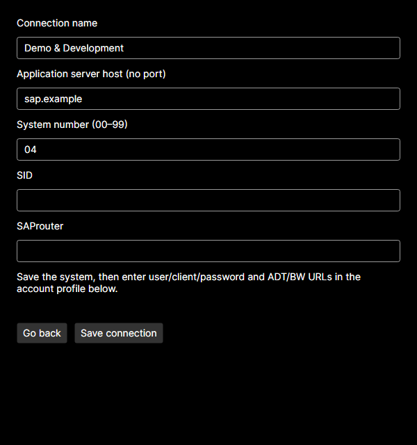

# Connection sources — with or without SAP GUI

[Türkçe](CONNECTIONS.tr.md) · [User guide](USER-GUIDE.md)

SAP GUI is not required to run these MCP servers. RFC uses PyRFC and the user-supplied NetWeaver RFC SDK; basic ADT uses HTTP/HTTPS. You still need network/VPN access, valid SAP credentials and authorizations. Some ADT operations require ready RFC. No actual SAP password is changed by this application.

## Choose the source

Open **SAP connections**. The manager checks known Windows SAP GUI registry/install locations and suggests a mode. Detection is a hint: choose either mode and select **Use selected source**. Your choice is saved and is not automatically changed when SAP GUI is installed or removed. The two system lists are separate; they are not merged. Switching sources preserves saved accounts and protected secrets. Profiles for the same `host:sysnr` are shared by both clients and both source modes.

If the open account form has unsaved changes, source switching, refreshing or system editing asks before discarding them. Cancel keeps the current form. Switching English/Türkçe preserves field values. Restart MCP servers in Codex/Claude after a source/path change so they use the new XML path.

## Without SAP GUI: application-managed connections

1. Select **Application-managed connections → Use selected source**. An empty local catalog and an MCP-compatible XML are created automatically if needed.
2. Select **New connection**. Enter a descriptive name, application-server hostname/IP and a two-digit system number (00–99). Do not enter a URL or port in the host field. SID (up to three letters/digits) and SAProuter are optional.
3. Select **Save connection**. Then select the system and enter profile name, user, client, SAP language, password and optional ADT/BW URLs in the account form below. Save the profile and choose the shared active account.
4. Install/validate the required runtimes and your SDK for RFC. Configure the MCP clients. Local MCP verification checks startup/tool discovery; an explicit Test connection contacts SAP.

Use **Edit connection** to change the name, server, system number, SID or router. The ID stays stable. A host/system-number change shows the affected profiles and asks before moving them and their active mapping to the new target for both clients. An existing connection or profile target is never silently overwritten.

**Delete connection** shows the system and associated profiles. Confirming removes the local system, its account profiles and active mappings. DPAPI secret files are retained, as with profile deletion; it does not delete a SAP GUI entry or account on SAP. Cancel makes no change. Removing a shared target's profiles also affects that target when used from the other source mode.

## With SAP GUI: read-only system list

1. Add/change/remove systems in SAP Logon itself.
2. In the manager choose **SAP GUI connections (read-only)**. Choose the SAP GUI folder or select `SAPUILandscape.xml` / `SAPUILandscapeGlobal.xml` directly. If both files exist, choose which one to use.
3. Select **Use selected source**. The manager reads direct SAPGUI host:port entries. Later select **Refresh systems** after SAP Logon changes the source file.
4. Select a loaded system and manage its user/client profiles and DPAPI passwords in the manager. System New/Edit/Delete buttons remain disabled in this mode, including at the service layer.

The source XML is never a write target. You may point to an existing XML even if SAP GUI is not installed. A missing/broken XML displays a connection-source error; the manager's other pages remain accessible. Select a valid file and apply/refresh. There is no silent fallback to a different source. Message-server groups, SNC/SSO and landscape include expansion are not supported in this preview.

## Which file does what?

| File | Purpose and ownership |
|---|---|
| External `SAPUILandscape.xml` / `SAPUILandscapeGlobal.xml` | SAP GUI's system catalog; read-only to this manager. It is XML, not JSON. |
| `config/connections.json` | Application-owned system catalog with schemaVersion, stable IDs, names, hosts, system numbers, SID and router. No passwords. |
| `config/SAPMcpLandscape.xml` | Application-generated projection of the JSON catalog, read by the existing RFC/ADT MCPs. Do not edit it by hand. |
| `config/sap_credentials.json` | Account mappings using overridesByTarget/secretRef, generated from active profiles. It is not a system catalog. |
| `secrets/*.password.dpapi` | Passwords protected with DPAPI CurrentUser. Other users/computers may require re-entry. |

Paths above are relative to `%LOCALAPPDATA%\SapMcpManager` by default; custom configurations keep their own data directory. The UI shows the managed JSON path. Existing mapping JSON can still be imported through **Import mapping**; its source is preserved. Importing a mapping does not discover or create servers.

Settings schema remains version 1 with optional `connectionSourceMode`, `externalLandscapeFile` and `managedConnectionsFile`. Old settings continue to use their existing landscape as the external read-only source until you explicitly choose another mode. Existing profiles, DPAPI files and client records remain valid. The manager repairs/rebuilds its generated projection when reopening a saved managed configuration; it never repairs the SAP GUI XML by writing into it.

All candidates are validated before a save. If a bundle write fails, the manager attempts to restore the previous catalog, mapping, XML and settings, and reports failure. If restoration itself fails, close MCP clients and repair the indicated configuration before continuing. Keep application-owned outputs separate from the external landscape and each other. An in-flight SAP call may already have resolved its account; list changes apply to later calls.

## Troubleshooting and support

- Empty list: apply the selected source first, then create a local system or choose a supported external XML.
- Folder contains no candidates: select the XML directly; only the two standard filenames are searched in that selected folder.
- Duplicate/target conflict: use a different endpoint or manage the existing system; no automatic profile merging occurs.
- Invalid host: provide the server name/IP without `https://`, a port, slash or whitespace. ADT/BW URLs belong in the profile.
- Changing an external file: edit it in SAP Logon and refresh. Choose application-managed mode if you want local CRUD instead.
- Access denied/invalid JSON: correct folder permissions or the catalog, then refresh/reopen. Do not remove the last valid configuration to bypass an error.

See [Troubleshooting](TROUBLESHOOTING.md) and the [reporting guide](ISSUES.md). Do not attach real catalogs, mappings, SDKs, secret files or unreviewed logs to public issues. Example formats in `examples/` use fictional systems. Clean Windows and live SAP acceptance remains pending unless recorded in the release validation report.

Managed mode supports password-free SAProuter strings. Password segments `/W/` and legacy `/P/` are rejected rather than stored in JSON/XML; secret-aware router support requires a future MCP change. See [SAP route-string syntax](https://help.sap.com/saphelp_em92/helpdata/en/48/6c62b71d5a350ce10000000a42189d/content.htm).
