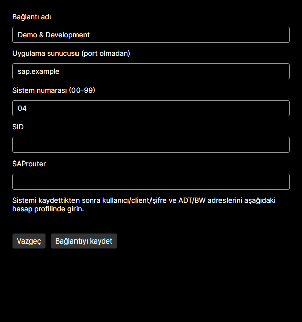

# Bağlantı kaynakları — SAP GUI ile veya olmadan

[English](CONNECTIONS.md) · [Kullanım kılavuzu](USER-GUIDE.tr.md)

Bu MCP sunucularını çalıştırmak için SAP GUI gerekmez. RFC, PyRFC ve kullanıcının sağladığı NetWeaver RFC SDK’yi; temel ADT HTTP/HTTPS kullanır. Ağ/VPN erişimi, geçerli SAP hesabı ve yetkiler yine gerekir. Bazı ADT işlemleri hazır RFC gerektirir. Uygulama SAP’deki gerçek parolayı değiştirmez.

## Kaynağı seçme

**SAP bağlantıları** ekranını açın. Yönetici bilinen Windows SAP GUI kayıt defteri/kurulum konumlarını kontrol edip mod önerir. Algılama öneridir: iki moddan birini seçip **Seçilen kaynağı kullan** deyin. Tercih saklanır; SAP GUI kurulunca/kaldırılınca kendiliğinden değişmez. İki sistem listesi ayrıdır, birleştirilmez. Mod değiştirmek kayıtlı hesapları ve korunan şifreleri silmez. Aynı `host:sysnr` için profiller iki istemci ve iki kaynak modu arasında ortaktır.

Açık hesap formunda kaydedilmemiş değişiklik varsa kaynak değişimi, yenileme veya sistem düzenleme öncesinde onay istenir. Vazgeç mevcut formu korur. English/Türkçe değişimi alanları korur. Kaynak/yol değişince yeni XML yolunu kullanmaları için Codex/Claude içindeki MCP’leri yeniden başlatın.

## SAP GUI olmadan: uygulamanın bağlantıları

1. **Uygulamanın bağlantıları → Seçilen kaynağı kullan** seçin. Gerekiyorsa boş yerel katalog ve MCP uyumlu XML otomatik oluşturulur.
2. **Yeni bağlantı** seçin. Açıklayıcı ad, uygulama sunucusu adı/IP ve iki rakamlı sistem numarası (00–99) girin. Sunucu alanına URL veya port yazmayın. SID (en fazla üç harf/rakam) ve SAProuter isteğe bağlıdır.
3. **Bağlantıyı kaydet** seçin. Sonra sistemi seçip alttaki hesap formunda profil adı, kullanıcı, client, SAP dili, şifre ve isteğe bağlı ADT/BW adreslerini girin. Profili kaydedip ortak aktif hesabı seçin.
4. RFC için çalışma zamanlarını ve SDK’nızı kurup doğrulayın. MCP istemcilerini ayarlayın. Yerel MCP doğrulaması başlangıç/araç listesini kontrol eder; açıkça başlattığınız bağlantı testi SAP’ye gider.

**Bağlantıyı düzenle** ile ad, sunucu, sistem numarası, SID veya router değişir. Kimlik sabit kalır. Sunucu/sistem numarası değişikliği etkilenen profilleri gösterir; iki istemcinin profillerini ve aktif mapping’ini yeni hedefe taşımadan önce onay ister. Mevcut başka bağlantı veya profil hedefinin üzerine sessizce yazılmaz.

**Bağlantıyı sil** sistem ve bağlı profilleri gösterir. Onay yerel sistemi, hesap profillerini ve aktif eşleştirmeleri kaldırır. Profil silmede olduğu gibi DPAPI şifre dosyaları korunur; SAP GUI kaydı veya SAP hesabı silinmez. Vazgeç hiçbir şeyi değiştirmez. Ortak bir hedefin profillerini kaldırmak o hedef diğer kaynak modundan kullanıldığında da etkili olur.

## SAP GUI ile: salt okunur sistem listesi

1. Sistem ekleme/değiştirme/silmeyi SAP Logon içinden yapın.
2. Yöneticide **SAP GUI bağlantıları (salt okunur)** seçin. SAP GUI klasörünü veya doğrudan `SAPUILandscape.xml` / `SAPUILandscapeGlobal.xml` dosyasını gösterin. İkisi de varsa kullanılacak dosyayı seçin.
3. **Seçilen kaynağı kullan** deyin. Yönetici doğrudan SAPGUI host:port kayıtlarını okur. Daha sonra SAP Logon değişikliklerinden sonra **Sistemleri yenile** kullanın.
4. Yüklenen sistemi seçip kullanıcı/client profilleri ve DPAPI şifrelerini yöneticiden düzenleyin. Bu modda sistem Yeni/Düzenle/Sil düğmeleri kapalıdır; servis katmanı da bu işlemleri reddeder.

Kaynak XML hiçbir zaman yazma hedefi değildir. SAP GUI kurulu olmasa da mevcut XML seçilebilir. Eksik/bozuk XML bağlantı kaynağı hatası gösterir; diğer yönetim sayfaları açılır. Geçerli dosyayı seçip uygulayın/yenileyin. Başka kaynağa sessiz geçiş yapılmaz. Message-server grupları, SNC/SSO ve landscape include genişletmesi bu önizlemede desteklenmez.

## Hangi dosya ne yapar?

| Dosya | Amaç ve sahiplik |
|---|---|
| Dış `SAPUILandscape.xml` / `SAPUILandscapeGlobal.xml` | SAP GUI sistem kataloğu; yöneticide salt okunur. JSON değil XML’dir. |
| `config/connections.json` | Şema sürümü, sabit kimlik, ad, sunucu, sistem numarası, SID ve router içeren uygulama kataloğu. Şifre içermez. |
| `config/SAPMcpLandscape.xml` | JSON kataloğundan üretilen, mevcut RFC/ADT MCP’lerinin okuduğu XML. Elle düzenlemeyin. |
| `config/sap_credentials.json` | Aktif profillerden üretilen overridesByTarget/secretRef hesap eşleştirmeleri. Sistem kataloğu değildir. |
| `secrets/*.password.dpapi` | DPAPI CurrentUser ile korunan şifreler. Başka kullanıcı/bilgisayarda yeniden giriş gerekebilir. |

Yollar varsayılan olarak `%LOCALAPPDATA%\SapMcpManager` altındadır; özel yapılandırmalar kendi veri klasörünü kullanır. Arayüz yönetilen JSON yolunu gösterir. Mevcut mapping JSON’u hâlâ **Mapping içe aktar** üzerinden alınabilir; özgün kaynak korunur. Mapping almak sunucuları keşfetmez veya oluşturmaz.

Ayar şeması isteğe bağlı `connectionSourceMode`, `externalLandscapeFile`, `managedConnectionsFile` alanlarıyla sürüm 1 olarak kalır. Eski ayarlar siz açıkça mod değiştirmeden mevcut landscape’i dış salt okunur kaynak olarak kullanır. Profiller, DPAPI dosyaları ve istemci kayıtları geçerlidir. Yönetici kaydedilmiş uygulama modunu tekrar açarken kendi üretilen XML’ini onarır/yeniden üretir; SAP GUI XML’ine yazarak onarım yapmaz.

Kayıttan önce aday veriler doğrulanır. Dosya grubu yazımı başarısızsa önceki katalog, mapping, XML ve ayarlar geri alınmaya çalışılır; hata gösterilir. Geri alma da başarısızsa MCP istemcilerini kapatıp devam etmeden belirtilen ayarları onarın. Uygulama çıktılarının yollarını dış landscape’ten ve birbirinden ayrı tutun. Devam eden SAP çağrısı hesabını önceden çözmüş olabilir; liste değişiklikleri sonraki çağrılara uygulanır.

## Sorun giderme ve destek

- Boş liste: önce kaynağı uygulayın, sonra yerel sistem oluşturun veya desteklenen dış XML’i seçin.
- Klasörde aday yok: XML’i doğrudan seçin; seçilen klasörde yalnız iki standart dosya adı aranır.
- Mükerrer/hedef çakışması: başka adres kullanın veya mevcut sistemi yönetin; otomatik profil birleştirme yapılmaz.
- Geçersiz sunucu: `https://`, port, eğik çizgi veya boşluk olmadan ad/IP girin. ADT/BW URL’leri profile yazılır.
- Dış dosya değişikliği: SAP Logon’da düzenleyip yenileyin. Yerel ekleme/düzenleme/silme için uygulama modunu seçin.
- Erişim yok/geçersiz JSON: izinleri veya kataloğu düzeltip yenileyin/yeniden açın. Hatayı atlamak için son geçerli ayarı silmeyin.

[Sorun giderme](TROUBLESHOOTING.tr.md) ve [bildirim kılavuzuna](ISSUES.tr.md) bakın. Gerçek katalog, mapping, SDK, şifre dosyası veya incelenmemiş logları public issue’ya eklemeyin. `examples/` biçimleri kurgusal sistemler kullanır. Sürüm doğrulamasında aksi kaydedilmedikçe temiz Windows ve canlı SAP kabulü bekler.

Uygulama modu şifresiz SAProuter dizelerini destekler. `/W/` ve eski `/P/` şifre bölümleri JSON/XML içine yazılmadan reddedilir; güvenli router şifresi desteği sonraki MCP geliştirmesini gerektirir. [SAP rota sözdizimine](https://help.sap.com/saphelp_em92/helpdata/en/48/6c62b71d5a350ce10000000a42189d/content.htm) bakın.
